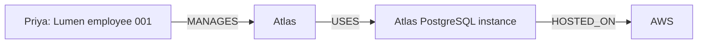
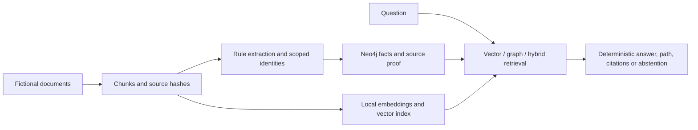

# GraphRAG for multi-hop question answering

A local, evidence-backed retrieval project that builds a typed knowledge graph from fictional documents, compares vector, graph and hybrid retrieval, and shows the source proof behind one-, two- and three-hop answers. It also preserves the cases where retrieval, extraction and question interpretation fail.

**Portfolio release: Stage 7B.2 licensed verification. Production readiness is not established.** Answer generation is deterministic. A free local MiniLM model supplies embeddings; this project does not evaluate a paid generative LLM. Graph and hybrid do not universally outperform vector retrieval.

Stage 7B.2 final verification: **436 tests pass**, including 129 real Neo4j integration tests. The current dependency audit reports zero findings; reviewed static warnings and advisory limitations remain. See [STAGE7B_SECURITY_REVIEW.md](docs/STAGE7B_SECURITY_REVIEW.md).

For a supported question, the graph can explain:



Each arrow is an actual typed relationship backed by a source quote, offsets, document hash and current ingestion run. The system abstains when identity is ambiguous, evidence is missing, the publication is stale or the question grammar is unsupported. Similar text alone is not enough to invent a direct relationship.

## Why compare these approaches?

A vector search can retrieve passages similar to a question without collecting every link needed to connect a person, project, database and hosting platform. A graph makes those links explicit and traversable. Building the graph also introduces extraction and identity errors. Hybrid retrieval can increase the evidence found while adding latency, and it does not automatically improve the deterministic answerer's coverage.

The implementation uses Python 3.12, FastAPI/Pydantic, Neo4j Community 5.26.32, the Neo4j Python driver, sentence-transformers with pinned all-MiniLM-L6-v2, PyTorch CPU, uv, pytest, Ruff and Docker Compose. There are no paid API requirements.



The graph schema has Person, Organization, Project, Technology and Platform identities, with MANAGES, WORKS_FOR, BELONGS_TO, USES and HOSTED_ON facts. Documents and chunks retain exact text evidence; source and ingestion nodes track current publications. Extraction is automatic but limited to reviewed sentence forms. Identity resolution uses type, aliases and scope, and rejects unresolved homonyms. Graph answers require actual bounded paths and proof replay, followed by publication revalidation.

## Results and what they mean

Stage 1 established typed schema, migrations, fictional source fixtures and real database/API checks ([report](docs/STAGE1_REPORT.md)). Stage 2 added automatic extraction, scoped identity resolution, ingestion lifecycle and provenance validation ([report](docs/STAGE2_REPORT.md)). Later stages introduced the real vector baseline, bounded graph retrieval, source alignment, hybrid fusion and the new controlled challenge.

| Experiment | Vector correct positives | Graph correct positives | Hybrid correct positives | Interpretation |
|---|---:|---:|---:|---|
| Stage 3 baseline | 45/96 (46.875%) | Not evaluated | Not evaluated | Vector struggled on longer chains |
| Stage 4 mismatched corpus | Historical vector unchanged | 0/96 (0%) | Not evaluated | All question starts were absent from that graph |
| Stage 5 aligned development set | 45/96 (46.875%) | 96/96 (100%) | 96/96 (100%) | Both splits had been inspected; not independent generalization |
| Stage 6 final controlled challenge | 0/128 (0%) | 54/128 (42.1875%) | 54/128 (42.1875%) | New grammar and extraction gaps caused many false abstentions |

The Stage 6 final set contains 180 questions: 128 answerable and 52 unanswerable. Eighteen calibration questions are separate. Graph/hybrid one-, two- and three-hop accuracy was 36/80 (45%), 14/36 (38.89%) and 4/12 (33.33%). Vector answered 0/80, 0/36 and 0/12 under its frozen answer grammar. All modes correctly abstained on 52/52 negatives. Graph and hybrid had 74/128 false abstentions; vector had 128/128.

Hybrid recovered complete text evidence for 86/128 positives (67.1875%), versus vector 58/128 (45.3125%) and graph 54/128 (42.1875%). Its validated graph chains and final correct answers remained 54/128. There were zero unsupported answers in this top-k 5 final comparison. Graph and hybrid citations passed 88/88 source checks each; vector emitted no citations, so its precision is N/A. A historical top-k 1 partial-answer failure remains a known limitation.

This is an author-controlled synthetic holdout, not an externally held blind or natural-document benchmark. The document split also changes question forms. Deterministic repeats matched 594/594 non-timing outputs, but that is repeatability on these examples, not statistical evidence of broad accuracy. See [FINAL_EVALUATION.md](docs/FINAL_EVALUATION.md) for every denominator, coverage gap and contamination limitation.

The original 50-user graph/hybrid bursts had 49/100 and 14/100 errors. Stage 7A reproduced pool acquisition failures at pool ten, then measured 0/100 errors for each mode with pool 50. Graph/hybrid p95 remained 17.27/17.91 seconds. The release template uses that tested setting. The host saturated one CPU; a single short before/after trial does not establish sustained capacity. [ENGINEERING_DECISIONS.md](docs/ENGINEERING_DECISIONS.md) records the tradeoff and historical errors.

## Run locally

From this publication directory, with Docker Desktop running:

```powershell
uv sync --locked
uv run python -m scripts.setup_env
docker compose up -d --wait --wait-timeout 180
uv run python -m scripts.vector prepare-model
uv run python -m scripts.portfolio prepare --dataset demo
uv run python -m scripts.portfolio demo --output .local/demo-results.json
```

The setup script generates a local password without printing it. The publication database uses loopback ports 37477/37690 and its own named volume. The first install/image/model preparation requires internet; inference and the demo are local and cache-only afterward. Do not point the demo at the research databases. [DEMO_GUIDE.md](docs/DEMO_GUIDE.md) explains all 24 actual responses, unsupported-grammar and ambiguity cases, source citations and the evaluation smoke commands. The new CLI corpus is separate from the historical API corpus wiring.

```powershell
uv run ruff check .
uv run ruff format --check .
uv run pytest --run-integration -q --junitxml=.local/test-results.xml
uv run python -m scripts.check_ci_results .local/test-results.xml
```

Integration tests require real Neo4j and the cached model, start disposable databases and must not silently skip. Allow time and memory for model startup; avoid running other load jobs simultaneously on a small machine. [STAGE7A_RELEASE_REPORT.md](docs/STAGE7A_RELEASE_REPORT.md) records the executed clean-environment checks and any failed attempts. The GitHub workflow covers lint, format and the full real integration suite; **GitHub-hosted CI remains UNVERIFIED** until an actual hosted run completes.

## Safety, limits and next work

There is no arbitrary Cypher endpoint. Traversal selects allowlisted templates with parameterized values and bounded hops/candidates/answers. Facts require source proof; stale publications invalidate retrieval. Document content is not executed. API errors use safe messages and request IDs, and credentials are redacted. Mutations belong to explicit local ingestion and preparation workflows. The local API has no authentication: this package is for loopback demonstration, not public exposure.

The release excludes `.env`, private logs, database files/volumes, model weights, caches and virtual environments. [SECURITY_REVIEW.md](docs/SECURITY_REVIEW.md) describes actual scans and their limits. Stage 7B upgraded Transformers and hardened the local verification tools. The current audit reports zero vulnerabilities across 60 installed packages; 12 low Bandit warnings and two upstream advisory-status caveats remain documented. Read [STAGE7B_PRECOMMIT_REPORT.md](docs/STAGE7B_PRECOMMIT_REPORT.md) for the current local commit gate and [STAGE7B_SECURITY_REVIEW.md](docs/STAGE7B_SECURITY_REVIEW.md) for advisory detail. The approved project license is MIT; see the License section below. Review the source/data rights and dependency/model notices in [THIRD_PARTY_NOTICES.md](docs/THIRD_PARTY_NOTICES.md) before publication; no database or model binary is bundled.

Future work includes broader externally held-out data, better extraction and question interpretation, proof-equivalent batched graph reads, bounded HTTP admission and repeated sustained load/recovery tests. Improving evidence recall and measuring actual answer gains must remain separate tasks.

Read [ARCHITECTURE.md](docs/ARCHITECTURE.md), [GRAPH_CONSTRUCTION.md](docs/GRAPH_CONSTRUCTION.md), [RETRIEVAL_MODES.md](docs/RETRIEVAL_MODES.md), [RESUME_AND_INTERVIEW.md](docs/RESUME_AND_INTERVIEW.md) and [PUBLICATION_MANIFEST.md](docs/PUBLICATION_MANIFEST.md). Historical stage reports are retained as dated research records; the current evaluation and release report govern portfolio claims. Stage 7B refreshed this local candidate after security checks. No Git repository, remote, commit, push or deployment was created.

## License

[MIT License](LICENSE). Copyright (c) 2026 Devendra Tapare. This applies only to first-party code and original material the owner owns or may license. Third-party dependencies, datasets, models and assets retain their own terms; see [THIRD_PARTY_LICENSES.md](docs/THIRD_PARTY_LICENSES.md). No dependency binaries or model weights are bundled.
