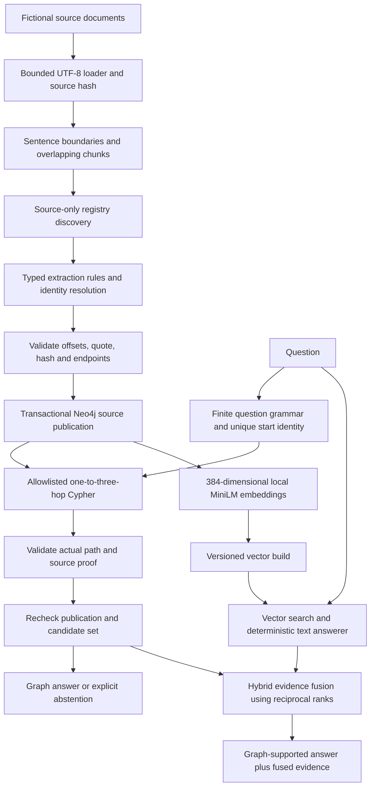

# Architecture

This is a local research implementation of evidence-backed multi-hop retrieval. It uses deterministic rules for extraction, question interpretation and answer rendering. MiniLM supplies embeddings; no paid API or generative LLM supplies answers.

The `app/extraction` package owns document loading, sentence and chunk offsets, registry resolution, rule extraction and proof replay. `app/repositories/ingestion.py` writes versioned runs and their facts. `app/vector` owns the supervised CPU model process, index publication, retrieval and the frozen baseline text answerer. `app/graph_rag` owns finite query plans, fixed Cypher templates, budgets and provenance checks. `app/aligned` adds a source-derived publication seal and hybrid fusion. `app/evaluation` and evaluation scripts are offline consumers of gold labels; runtime retrieval does not import those labels.

The graph has five entity labels: Person, Organization, Project, Technology and Platform. Five factual relationships are allowed: MANAGES, WORKS_FOR, BELONGS_TO, USES and HOSTED_ON. Documents, Chunks, IngestionSource and Ingestion nodes retain evidence and lifecycle state. MENTIONS and PART_OF describe evidence structure and cannot substitute for factual hops. Four idempotent migrations add identity constraints, lookup indexes, ingestion lifecycle fields and vector publication support. Neo4j Community 5.26.32 is pinned in Compose.

Each accepted automatic fact records its source document, source identity, content hash, ingestion run, processing version, evidence chunk, exact quote and offsets. Proof validation reconstructs the relation from that source span and checks the endpoints. A graph answer requires an actual Neo4j path, complete source proof for every edge, current source runs, a complete bounded candidate set and final revalidation. A manually invented direct Priya-to-AWS edge is never needed: the supported path is Priya → Atlas → PostgreSQL → AWS.

The vector model is `sentence-transformers/all-MiniLM-L6-v2`, revision `1110a243fdf4706b3f48f1d95db1a4f5529b4d41`, with normalized 384-dimensional vectors and a 256-token limit. Model preparation needs network access once. Inference is cache-only, uses CPU and disables remote model code. A single supervised worker serializes embedding calls; waiting for its lock becomes expensive under load. Missing models, oversized inputs and worker failures are explicit errors rather than silent fallback embeddings.

Graph search has at most three hops, 128 candidates and ten answers in the measured configuration. Plans select fixed relationship templates; question text is a parameter, never executable Cypher. Graph operations share a 20-second request budget; hybrid uses 60 seconds. Query limits remain ten seconds for graph operations, connection acquisition three seconds and read managed retries zero. These are cooperative application and driver budgets, not hard operating-system cancellation deadlines.

The aligned seal checks all source publications and accepted fact identifiers before capture and rechecks before answering. This rejects stale, incomplete or forged publications, but adds database round trips even for a short path. Historical profiles measured 16/18/20 calls for one/two/three hops. A metadata query scanned all 211 Chunk labels in the challenge corpus. Batching and a cheaper equivalent seal are future engineering work, not completed optimizations.

Hybrid first retrieves vector evidence, expands graph candidates using resolved entities, validates graph paths, and fuses evidence ranks. The final answer still needs the graph grammar and proof. This explains Stage 6: hybrid text-chain coverage rose to 86/128 answerable questions, but graph and hybrid both answered only 54/128. Unsupported question forms remained unsupported, and missing extracted relations remained missing. Additional retrieved text did not become a generative reasoning capability.

FastAPI uses synchronous route handlers, which are dispatched to worker threads. Health and readiness handlers also use that worker pool and may be delayed by saturation. Historical load tests invoked services directly through threads, so those measurements do not test HTTP admission, event-loop delay or production availability. There is no authentication layer or public deployment in this release. Compose binds the database to loopback. Use the source-only CLI demo in [DEMO_GUIDE.md](DEMO_GUIDE.md).

See [GRAPH_CONSTRUCTION.md](GRAPH_CONSTRUCTION.md), [RETRIEVAL_MODES.md](RETRIEVAL_MODES.md), [ENGINEERING_DECISIONS.md](ENGINEERING_DECISIONS.md) and [FINAL_EVALUATION.md](FINAL_EVALUATION.md) for the detailed construction, retrieval and evaluation contracts. The original Stage 1 architecture remains in the research directory; the publication uses this current architecture.
