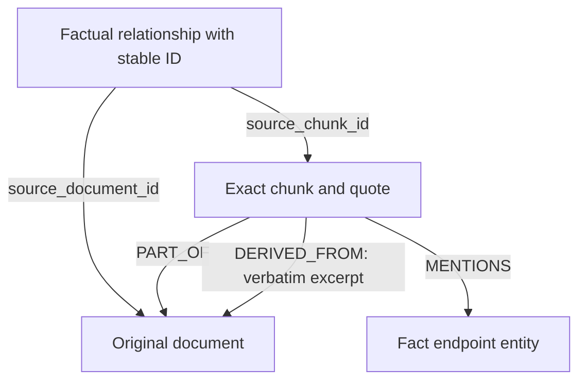

# Source provenance

This document describes the unchanged manually curated Stage 1 corpus. Stage 2 automatic assertions use a separate contract described in [PROVENANCE_VALIDATION.md](PROVENANCE_VALIDATION.md); they never overwrite these curated properties or source IDs.

The corpus, people, organizations, and project assignments are fictional. Technology and cloud names are used as labels in fictional deployment scenarios. No employee, customer, or confidential corporate data is included. No model API produced or extracted the facts.

`data/fixtures/corporate.json` stores the original documents, exact chunks, entity records, and 30 curated factual assertions. `scripts/build_fixtures.py` reproduces the same data. Each document has one chunk spanning the complete text. Offsets use Python Unicode character positions: start inclusive, end exclusive. They are not UTF-8 byte offsets.

Each factual edge contains:

| Property | Purpose |
| --- | --- |
| `id` | Stable assertion identity |
| `source_document_id` | Source document to cite |
| `source_chunk_id` | Exact evidence excerpt to resolve |
| `quote` | Supporting sentence contained verbatim in the chunk |
| `extraction_method` | `manual_fixture` for all Stage 1 facts |
| `confidence` | Curator-assigned value; not a measured model probability |
| `created_at` | Fixed UTC creation timestamp for deterministic loading |
| `fixture_id`, `fingerprint` | Dataset ownership and immutable snapshot checks |

To cite a future retrieved path, resolve **each fact edge** to its chunk, verify the chunk belongs to the claimed document, compare its offsets/text with the immutable source, and return the document ID/title and supporting quote. The current validator performs these integrity checks by comparing every live record with the validated fixture. Citation rendering and answer generation are future work.

For the main example:

| Fact | Supported assertion | Source |
| --- | --- | --- |
| `fact:001` | Priya manages Atlas | `doc:01`, `chunk:01` |
| `fact:003` | Atlas uses its PostgreSQL instance | `doc:02`, `chunk:02` |
| `fact:005` | Atlas's PostgreSQL instance is hosted on AWS | `doc:03`, `chunk:03` |

The answer AWS is justified by the three-edge path. There is no fabricated `Priya → HOSTED_ON → AWS` edge. Atlas East's hosting fact supports a different technology ID and cannot serve as Atlas evidence.

Snapshot equality checks catch missing/orphaned evidence, changed quotes, changed endpoints/directions, duplicate facts, missing nodes/edges, and modified source text. Pydantic validation catches invalid source offsets and quotes before loading. These checks prove consistency with a curated fixture; quote containment by itself does not prove that an arbitrary natural-language assertion is true. Future extraction must add entailment review, conflict handling, document versioning, and multiple-source support.

Ivo and Una are mentioned in the directory text but have no sourced employment or management facts. Their entity records remain isolated in this minimal graph. `MENTIONS` currently represents endpoints extracted for factual assertions, not an exhaustive named-entity index of every word in a document. Unknown facts stay unknown.

The evaluation file contains nine cases, six answerable and three unanswerable. Each answerable case records an ordered node path, supporting fact IDs, the exact source document set, and the expected endpoint answer. The unanswerable cases explain missing management evidence, missing hosting-region detail, or the ambiguous Lee Chen name. These are expected outcomes for a future retrieval evaluator; Stage 1 does not run a QA model or claim answer accuracy.
