# Graph construction

The automated graph is built from fictional source sentences. The runtime never uses expected answers or gold graph paths to create facts. Historical curated Stage 1 fixture facts are a separate development artifact; the new portfolio runner ingests the fixture document text through the automatic pipeline and permits only that publication's automatic facts.

```mermaid
flowchart LR
    S[Source text] --> H[Portable source identity and SHA-256]
    H --> C[Sentence-aware chunks with document offsets]
    C --> D[Registry discovery from source grammar]
    D --> R[Conservative identity resolution]
    R --> E[Typed relationship candidates]
    E --> V[Replay quote and rule proof]
    V --> W[Atomic source-run publication]
    W --> X[Current graph facts and evidence chunks]
```

The local loader accepts only `.txt` and `.md` beneath the fictional root, checks Windows and POSIX path syntax, rejects traversal, symlinks and junctions, limits bytes and requires valid UTF-8 without NUL. It reads content as text. Document text is never a shell command, Python program or Cypher template. These controls are a local workflow boundary, not a hardened multi-tenant upload service. The Stage 6 actual junction escape was rejected; real symlink creation was not exercised in that environment, and the symlink branch has unit coverage.

Logical source identity is separate from the immutable document snapshot hash. Changes create a new processing run. Sentence boundaries preserve offsets; overlapping chunks provide retrieval context without treating an overlap as a new real-world fact. Stable identifiers and idempotent ingestion prevent duplicate facts across repeat imports. Run claims, lease state and source publication prevent partially written runs from being mistaken for ready evidence. Failed or superseded content cannot remain an accepted current source silently.

Discovery recognizes a finite set of supported sentence forms, such as management, employment, project ownership, technology usage and hosting. It skips non-asserted or code contexts. It starts from the reviewed 27-identity registry and adds source-derived identities; this is not unrestricted named entity recognition. Exact surface matches, type, organization scope and project-specific technology scope resolve identity. Qualified employee names distinguish homonyms. The technology instance for Atlas is distinct from another project's identically named database. Bare ambiguous names abstain instead of choosing a convenient match.

The pipeline accepts only these directed types:

| Relation | Source type | Target type |
|---|---|---|
| MANAGES | Person | Project |
| WORKS_FOR | Person | Organization |
| BELONGS_TO | Project | Organization |
| USES | Project | Technology |
| HOSTED_ON | Technology | Platform |

Automatic facts retain source ID, document ID, hash, processing version, ingestion ID, evidence chunk, exact quote and document/mention offsets. Validators check entity types and aliases, quote containment, offsets, current source/run and rule replay. MERGE keys preserve stable identity while graph publication switches only after the intended source run is complete. Invalidation includes derived facts and vector build consistency. Source proof is checked again when graph paths are used, not trusted merely because ingestion once succeeded.

The challenge produced 260 new stored identities, 243 accepted facts and 211 documents; all 243 accepted facts passed provenance checks. The generated registry has 287 entries including 27 inherited entries that are not all stored in that database. There were 271 exact mention coalescences, which is not an independently measured entity-merge precision score. Discovery rejected 48 sentences: 44 non-asserted and four unsupported. Another 12 semantically relevant statements were not extracted and affected 20/128 final answerable questions. Thirty-four documents yielded no facts. Construction coverage was complete for 108/128 final answerable questions, or 84.375%, and query grammar caused further losses.

These are precision-oriented engineering choices. Proof can establish that accepted facts came from the supplied fictional text; it cannot establish the truth of that text or recover relations the rules do not recognize. See [FINAL_EVALUATION.md](FINAL_EVALUATION.md) for extraction and query coverage limits, and [DEMO_GUIDE.md](DEMO_GUIDE.md) for a source-only rebuild.
