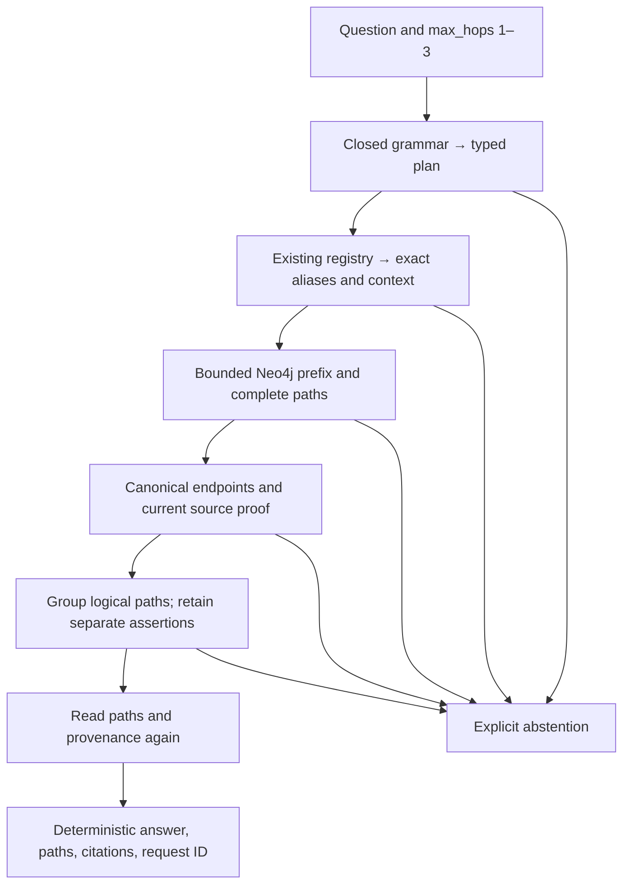

# Graph retrieval architecture — Stage 4

The graph-only endpoint follows actual Neo4j relationships and checks the source of every edge. It uses a closed question grammar and the existing canonical registry. It makes no model calls and does not use embeddings, vector search, evaluation answers, or an unrestricted Cypher endpoint.

`app/graph_rag/interpretation.py` returns a typed plan; `linking.py` resolves the starting ID; `repository.py` obtains paths and source metadata; `provenance.py` verifies proof; `service.py` selects and renders the answer. Strict contracts live in `models.py`. `app/api/graph_rag.py` exposes `POST /api/v1/rag/graph/query`; `scripts.graph_rag` exposes plan/link/query commands. Offline evaluation is under `app/evaluation/graph.py` and separate scripts; the runtime does not import it.

Only five factual types are allowed, with stored directions:

| Relationship | Source | Destination |
| --- | --- | --- |
| MANAGES | Person | Project |
| WORKS_FOR | Person | Organization |
| USES | Project | Technology |
| HOSTED_ON | Technology | Platform |
| BELONGS_TO | Project | Organization |

Inverse questions reverse traversal while preserving the stored edge direction in the response. `MENTIONS`, `PART_OF`, and `DERIVED_FROM` are used only for provenance, never as reasoning hops. No new schema migration or index is needed: existing canonical ID indexes support the starting-node lookup. Query labels and relationship types come exclusively from revalidated enums; mentions and IDs are parameters. Templates use exact lengths, not variable-length expansion.

Default limits are 1,000 question characters, 200 characters per captured entity/context, three factual hops, 128 total raw prefix/full candidates, ten answer identities, ten seconds per Cypher query, and twenty seconds per request. Settings permit at most 256 candidates, twenty answers, thirty query seconds, and sixty request seconds. The ingestion document byte limit also bounds proof input. Prefix and complete paths share one budget. A sentinel beyond the candidate limit forces abstention; no partial candidate set is selected. Every database read uses the remaining request deadline.

The fixed source manifest `data/runtime/graph_corpus_v1.json` contains the same 92 approved automatic source IDs and processing version as the frozen baseline, plus the original curated fixture identity. It is a source allowlist, not an embedding dependency. New corpus publication requires an explicit manifest review; ingestion alone does not expand graph-query scope. Automatic assertions must also belong to current ready source/run publications. Source history remains stored but is ineligible.

The service validates all captured candidates, groups identical canonical node sequences, retains separate supporting assertion IDs per edge, and sorts output deterministically. It checks every known valid prefix for a continuation. Missing intermediate evidence causes abstention even when another branch completes. Singular questions with different supported final identities abstain and retain alternatives. Explicitly plural questions return the complete bounded set. Several paths ending at the same canonical answer may all support one answer.

The API returns `answer`, `answers`, `abstained`, `reason`, `retrieval_mode=graph_multi_hop`, `generator=deterministic_graph_v1`, the plan, resolution, hop count, paths, evidence chunks, citations, diagnostics, request ID, and phase timings. `reasoning_path` is a convenience field only for an answered single logical path. `reasoning_paths` holds complete validated alternatives, including conflicting ones on abstention. Evidence chunks may include validated prefixes; those chunks alone never authorize an answer. Flat answer citations remain empty on abstention.

Validation failures return 422. Database failures return a sanitized 503 with a request ID. Query/request timeouts return 504; detected concurrent graph changes return 503. Infrastructure errors contain no answer or paths. Unknown entities or unsupported grammar can abstain before touching Neo4j, including during an outage. Health checks process liveness; readiness checks database connectivity, not complete corpus correctness.

Paths and metadata are reread before answering. A changed assertion, candidate set, source publication, or proof payload rejects the request. This detects changes across the validation window; it is not an atomic database snapshot spanning the final HTTP response. Transaction deadlines are server-enforced bounds plus application checks, not an operating-system hard cancellation guarantee. See [security verification](GRAPH_SECURITY_TESTS.md).
