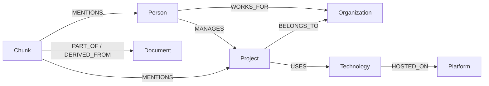

# Knowledge graph schema

Every domain node also has the `GraphNode` label. `GraphNode.id` is globally unique across domain labels. Display names are not identifiers.

| Label | Count | Meaning and identity example |
| --- | ---: | --- |
| Person | 8 | A fictional person; `person:lee-north` |
| Organization | 3 | A fictional organization; `org:cedar` |
| Project | 6 | A scoped project; `project:atlas` |
| Technology | 6 | A deployment/instance used by a project; `tech:postgres-atlas` |
| Platform | 3 | A cloud platform; `platform:aws` |
| Document | 12 | Original immutable fictional source; `doc:01` |
| Chunk | 12 | Exact source excerpt with character offsets; `chunk:01` |

The six technology records include two PostgreSQL deployments. A generic product name does not establish a shared deployment. `HOSTED_ON` therefore applies to a scoped technology instance. It does not assert that every installation of that product runs on one platform.

| Direction | Count | Meaning |
| --- | ---: | --- |
| Person → MANAGES → Project | 6 | Source explicitly names the project's manager |
| Person → WORKS_FOR → Organization | 6 | Source explicitly states employment |
| Project → USES → Technology | 6 | Source names a technology instance used by the project |
| Technology → HOSTED_ON → Platform | 6 | Source identifies that instance's cloud platform |
| Project → BELONGS_TO → Organization | 6 | Source assigns the project to the organization |
| Chunk → MENTIONS → entity | 37 | Extracted mention supporting a fact endpoint; no employment/ownership inference |
| Chunk → PART_OF → Document | 12 | Structural membership of the source chunk |
| Chunk → DERIVED_FROM → Document | 12 | The chunk was copied verbatim from that document, with offsets |

`PART_OF` and `DERIVED_FROM` currently point to the same document. The first describes membership; the second records the excerpt derivation method. Later transformed artifacts can require different derivation semantics. These structural edges do not assert new corporate facts.

All factual relationships carry `id`, `source_document_id`, `source_chunk_id`, `quote`, `extraction_method`, `confidence`, `created_at`, `fixture_id`, and a snapshot fingerprint. `created_at` is an ISO 8601 UTC string in this fixture. Confidence 1.0 means manually curated for this fictional corpus; it is not an empirically calibrated probability. Structural edges carry deterministic IDs, scope, and fingerprints; `DERIVED_FROM` also records `method=verbatim_excerpt`.

Fact IDs (`fact:001` through `fact:030`) are fixed in the versioned corpus. Structural relationship IDs hash type, source ID, and target ID. This prevents collisions between different edge meanings or different endpoints. Multiple supporting assertions for the same subject/predicate/object can later use different fact IDs and source chunks. They must not overwrite one another.

`001_identity.cypher` creates uniqueness constraints on global domain IDs, all seven domain labels, the fixture lock ID, and each of the eight relationship types' IDs. The migration runner separately creates the schema-version uniqueness constraint. Stage 1 creates **18 named uniqueness constraints**. Relationship uniqueness is per type; loaders additionally check an incoming ID across all types to prevent a cross-type collision.

`002_lookup_indexes.cypher` adds three range indexes: `(GraphNode.normalized_name, GraphNode.scope)`, `GraphNode.fixture_id`, and `Chunk.document_id`. Uniqueness constraints also create backing indexes. Neo4j has default lookup indexes; those are not additional application-authored indexes. Validation checks required names, labels/types, properties, constraint types, and index online state.

Community uniqueness constraints do not require every node or relationship to have an ID or enforce endpoint types. The strict loader and snapshot validator enforce those properties for the fixture. Direct Browser writes can bypass application rules and must be validated afterward.

Names are normalized with Unicode NFKC, case folding, and whitespace collapse. Original names are preserved. A duplicate logical entity is a repeated `(label, normalized_name, scope)`. Distinct scopes are intentionally allowed: the two Lee Chen people use separate employee scopes, and the two PostgreSQL instances use separate project deployment scopes.

Future entity resolution must use source-local IDs, organization/employee context, and explicit reviewed matches. A name match alone must not merge people, organizations, or technology deployments. Ambiguous names require clarification or multiple candidates. Never infer employment from project management or organization ownership by traversing a path and then storing an unsupported direct edge.

Stage 1 operational metadata consists of two `SchemaMigration` records and one `FixtureLock`. They are excluded from the **50-node, 91-edge** fixture totals. Before Stage 2, an otherwise empty database has 53 physical nodes and 91 relationships after loading.

## Stage 2 additions

The seven domain labels and eight relationship directions are preserved. Migration `003_ingestion_lifecycle.cypher` adds uniqueness for operational `IngestionSource.id` and `Ingestion.id`, plus range indexes for run source ID, run status, and document source ID. The project now defines **20 uniqueness constraints and 6 explicit range indexes**. Default and constraint-backing indexes are additional database-managed indexes.

Automatic Document/Chunk records use `autodoc:` / `autochunk:` IDs and `origin=automatic_ingestion`, without a curated `fixture_id`. Curated nodes and their fingerprints remain unchanged. Source documents are immutable hash snapshots; the stable logical source lives in `IngestionSource`. Runs store lifecycle state, versions, counts, timestamps, and rejected candidates.

Automatic entity mentions reuse reviewed canonical entity IDs. The registry adds the distinct `person:priya-cedar` without merging it with `person:priya`. An entity already present in Stage 1 is matched and retained, never overwritten with extraction metadata.

Factual relationships keep the existing types but use `auto-fact:` assertion IDs. Each source/span/version has its own edge and provenance. Structural PART_OF/DERIVED_FROM connect automatic chunks to their source snapshot. MENTIONS records grounded mention spans. Every automatic edge carries its owning `ingestion_id`; automatic facts also carry exact quote/offset/hash/version and `provenance_status=verified_rule`.

Eligibility requires the source's current ready run and the reader's current processing version. Historical or partial automatic facts must not be retrieved through bare matches. Stage 1 validation continues to require exactly its original 50 nodes/91 edges; ingestion-owned edges between canonical fixture entities are checked separately by ingestion validation. Unexpected unowned fixture edges still fail validation.

See [provenance validation](PROVENANCE_VALIDATION.md) and [automatic extraction](AUTOMATIC_EXTRACTION.md) for the full publication and consistency contract. Physical graph totals now depend on retained ingestion history and are not the Stage 1 fixture totals.

## Stage 3 additions

Migration `004_chunk_vectors.cypher` adds operational `ChunkEmbedding`, `VectorBuild`, and `VectorCorpus` ID uniqueness constraints and the `chunk_minilm_cosine` vector index. Required project schema now contains **23 uniqueness constraints, 6 explicit range indexes, and 1 vector index** (32 total indexes including constraint backing and default lookups on this database). The vector index uses `ChunkEmbedding.embedding`, 384 dimensions, and cosine similarity on Neo4j Community 5.26.32.

Embedding records reference original Chunk/Document IDs through properties and store ordinary float lists. No labels or properties are added to immutable curated/automatic source nodes. There are no new relationship types. Build publication and source eligibility use node metadata, allowing vector-only retrieval to avoid all relationship traversal. See [vector indexing](VECTOR_INDEXING.md) for model/version identities, completeness checks, publication leases, stale filtering, and Community representation details.
