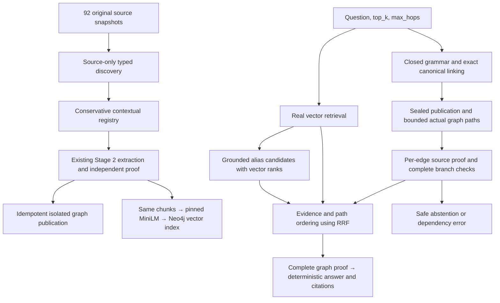

# Hybrid GraphRAG architecture

Stage 5 exposes three modes over the same 92 source-document versions in a separate Neo4j Community 5.26.32 instance: `vector_only`, `graph_only`, and `hybrid_graph_vector`. Historical Stage 1–4 data and results stay in the original instance. No paid model, general-purpose LLM, inferred similarity edge, or unrestricted Cypher endpoint is used.



`app/aligned/discovery.py` reads only full positive, non-code source sentences. It discovers types from grammatical roles and records exact source spans. It never reads questions, answers, gold IDs, or labeled paths. The existing extractor already supports the source corpus's manages/leads, employment, uses/utilizes, ownership, and hosted-on/runs-on statements; Stage 5 does not broaden relationship acceptance to chase missing labels. Generated registry data feeds unchanged Stage 2 extraction, provenance validation and managed lifecycle writes.

Organizations/projects use exact complete names, with source-supported ownership scopes when identical project names occur under different organizations. People use explicit employee qualifiers where present, or source-supported full-name/employer context. Indistinguishable unqualified names remain ambiguous when several contexts exist. Reviewed base aliases are preserved; no fuzzy or prefix merge is introduced. Technologies are project-scoped deployments, not global products. Existing reviewed product aliases, such as Postgres/PostgreSQL, may refer to the same product within one deployment. A new person's first name is not automatically added as an alias.

The identity policy is for a controlled fictional corpus. Equal unqualified names and one employer are treated as one local identity unless explicit conflicting identity context exists. This cannot establish real-world identity for otherwise indistinguishable homonyms. New canonical IDs hash typed source-derived names and scope; none comes from evaluation labels. `identity_audit.json` records actual stored new/reused identities and the tested merge checks.

`app/aligned/graph.py` is a versioned fork of the Stage 4 selection service. The original Stage 4 runtime remains byte-identical. Stage 5 reuses its typed plans, bounded exact Cypher templates, actual path capture, independent endpoint/source proof, and final path/source revalidation. It adds set-valued branch semantics: several managed projects may legitimately yield several technologies/platforms. Different final answers across independent subjects are not inherently contradictory. Different WORKS_FOR, BELONGS_TO or HOSTED_ON targets for the same stored subject cause conservative abstention. A known incomplete branch also abstains. An invalid distinct candidate branch cannot disappear behind a different valid path; invalid duplicate support can be ignored when the same canonical prefix has valid independent proof.

`app/aligned/integrity.py` checks the frozen evaluation publication before path capture and again during final revalidation. `stage5_corpus.json` contains the source-only document/hash manifest and accepted assertion identities generated by the validated extractor. Bounded parameterized lookups require the approved current ready source/run/document versions and every sealed typed assertion ID with its original endpoints. This detects deleted first-hop branches that ordinary path enumeration cannot see. The seal only rejects incomplete builds: it never supplies a path or an answer. Actual answers still require Neo4j paths and per-edge proof. The runtime caps this seal at 256 source documents and 2,048 assertions; current size is 92/150. Relationship IDs use existing indexes; no unrestricted graph scan is exposed.

The sealed evaluation API requires the entire approved publication to remain coherent. A changed/failed approved source invalidates this publication and produces safe `aligned_build_incomplete` until a source-only rebuild/index publication and API restart. Historical assertions remain stored; independent source assertions are not deleted. Underlying ingestion/proof services retain independent-support behavior, verified in isolated tests. This stricter fixed-build availability policy preserves the exact shared versions used in the comparison.

Hybrid mode calls the unchanged Stage 3 `VectorOnlyService` against the aligned database. Candidate discovery matches grounded chunk aliases to the source-derived registry; ambiguous candidates are retained rather than ranked into an identity decision. The question must independently resolve uniquely. A nearby vector hit cannot replace an unknown start or resolve a homonym arbitrarily. Candidate entity ranks corroborate validated paths and break evidence-order ties; they cannot create facts or endpoints.

Evidence fusion uses `1/(60 + vector_rank) + 1/(60 + graph_rank)` where present. Graph evidence has a deterministic canonical document/chunk ordering; this is a reproducible tie order, not a confidence estimate. Raw cosine scores are reported separately and never added to rule confidence. Paths are ordered by their source-evidence fusion scores, matched entity ranks, then canonical IDs. All required graph support survives fusion; no top-k cutoff removes an intermediate fact. Citations are deduplicated by actual assertion identity and ordered by fused evidence. Similarity affects presentation order, not whether an assertion is accepted.

Hybrid answers require a complete current validated graph chain. A vector-only answer candidate is diagnostic and cannot become the final answer when graph proof is missing. Thus `hybrid_no_expansion` may abstain where the frozen text answerer could answer. Responses keep `vector_evidence`, `candidate_entities`, `reasoning_paths`, `fused_evidence`, final `citations`, request ID, reason and phase timings separate. `vector_answer_candidate` is explicitly unaccepted diagnostic text, not another final answer.

The new endpoints are:

| Endpoint | Mode |
| --- | --- |
| POST `/api/v1/rag/aligned/vector/query` | Unchanged Stage 3 vector-only runtime on aligned sources |
| POST `/api/v1/rag/aligned/graph/query` | Stage 5 aligned graph-only |
| POST `/api/v1/rag/hybrid/query` | Hybrid graph/vector |
| GET `/api/v1/rag/aligned/ready` | Isolated database connectivity |

Old vector/graph endpoints continue using their original corpus and runtime. Health remains process liveness; readiness is not a full source/model audit. New clients validate question length (1,000), top_k (1–10), max_hops (1–3), strict scalar types and unknown fields. Existing graph limits remain 128 raw prefix/full candidates, ten answers, ten seconds per query and twenty seconds for graph work. Hybrid checks a sixty-second application budget around operations. The frozen model/driver have their own bounded calls; this is not hard process cancellation through response serialization. Safe 422/503/504 responses contain a request ID and no fabricated answer. Source changes after the final read remain a concurrency limitation.

Services are initialized lazily, with no database/model preload required for API liveness. `AlignedComponents` owns and closes its own isolated database client and local model worker. The CLI exposes the same modes:

```powershell
uv run python -m scripts.aligned --mode graph_only --question 'Which project does Morgan manage?'
uv run python -m scripts.aligned --mode hybrid_graph_vector --question 'Which database does Project Atlas use?' --top-k 5 --max-hops 3
```
