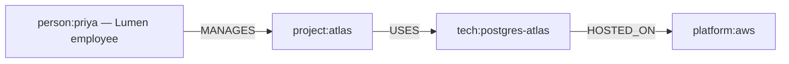
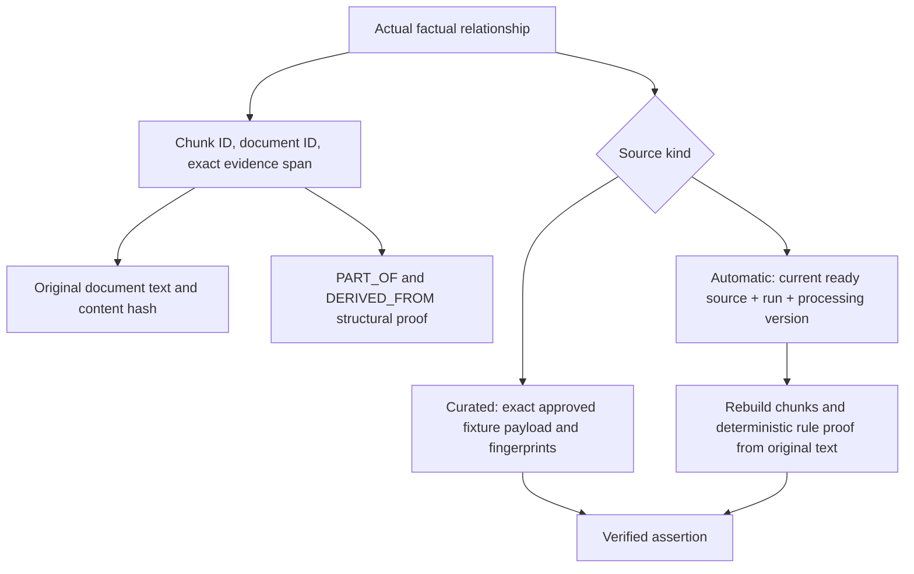

# Evidence-chain reasoning

Stage 4 recognizes a documented finite question language. It does not attempt general natural-language understanding. Examples include “Which project does Morgan manage?”, “Which organization employs Morgan?”, “Which database does Project Atlas use?”, “Which organization owns Project Delta?”, and “On which platform is the Postgres instance for Project Atlas East hosted?”. Two-hop forms ask for a managed project's technology, a project's technology host, a managed project's owner, or a project's manager's employer. Three-hop forms ask for the platform hosting the technology used by a managed project. `Who manages Project …?` follows MANAGES in reverse.

The parser accepts defined paraphrases such as lead/manage, use/utilize, and responsible-for patterns. Exact productions are versioned as `graph-grammar-v1` in `interpretation.py`. It reports supported status and a rule ID, rather than inventing a statistical confidence score. Other grammar explicitly abstains. A parsed chain requiring more than the caller's `max_hops` abstains with `requested_hop_limit`.

The following is an actual original-domain chain, independently verified against Neo4j by `scripts.verify_graph`:



Use the qualified person name: plain Priya has two reviewed identities and correctly abstains.

```powershell
uv run python -m scripts.graph_rag query --question 'Which cloud platform hosts the database used by the project managed by Priya (Lumen employee 001)?' --max-hops 3
$body = @{
  question = 'Which cloud platform hosts the database used by the project managed by Priya (Lumen employee 001)?'
  max_hops = 3
} | ConvertTo-Json
Invoke-RestMethod -Method Post http://127.0.0.1:8000/api/v1/rag/graph/query -ContentType 'application/json' -Body $body
```

The deterministic answer is AWS. The original curated assertions are `fact:001`, `fact:003`, and `fact:005`, supported by distinct original documents `doc:01`, `doc:02`, and `doc:03`. Current automatically extracted assertions also support these steps. Responses preserve their actual IDs, exact quotes and offsets; `reports/stage4/operational_verification.json` contains complete real responses. A response never constructs a synthetic path from this example or an answer key.



Curated proof requires exact trusted endpoint, relationship, document/chunk and structural-link properties. The fixture manifest is used as a proof contract only after an actual stored edge is retrieved. Automatic proof checks source/run publication, IDs, content hashes, processing version, document size, full expected chunk set, exact spans and stored candidate JSON. It reruns the existing Stage 2 extraction/provenance validator on the original source and compares the complete accepted assertion payload. A high rule score cannot substitute for these checks. No model infers missing links.

Independent assertions remain separate supports. Failure of one source does not remove another current valid assertion. Curated and automatic copies of the same original document are separate assertions but not independent original sources. The runtime retains that distinction; offline grading collapses verified identical source copies.

Project Beacon has supported hosting assertions for AWS and GCP. A singular platform question abstains with `conflicting_answers` and returns both validated alternatives for review. A supported plural platform question returns `AWS; GCP`. Different intermediate paths ending at one canonical answer are compatible and all remain visible. A candidate/answer cap abstains rather than returning a truncated set. Cycles do not grant extra hops; unsupported shortcut edges do not replace an approved sequence.

Missing, orphaned, stale, failed, corrupted, or unsupported evidence cannot authorize an answer. Known incomplete branches also force abstention. Diagnostic alternatives are validated paths, not speculative answers. The system proves that the frozen controlled sources support each assertion; it does not independently establish the real-world truth of fictional source text.
