# Provenance validation boundary

An extractor proposes candidates. It cannot make a relationship trusted by assigning a high score. `ProvenanceValidator` independently checks the source and the approved grammar. The writer repeats proof checks before persistence and checks persisted document/chunk data inside the managed transaction.

```mermaid
flowchart LR
    Candidate[Proposed relation] --> Source[Document identity, hash and loader version]
    Source --> Chunk[Chunk exists; text and offsets match]
    Chunk --> Span[Exact original sentence and evidence span]
    Span --> Mentions[Both mentions grounded in that evidence]
    Mentions --> Grammar[Approved positive pattern and direction]
    Grammar --> Identity[Unambiguous canonical IDs and endpoint types]
    Identity --> Current[Current processing version and source claim]
    Current --> Stored[Persisted source proof inside write transaction]
    Stored --> Assertion[Separate automatic assertion]
```

Before an accepted relation is written:

1. Document ID must identify the exact source/hash snapshot, and SHA-256 must match its original text.
2. The chunk must belong to that document, carry the same hash and processing version, and equal the original text slice.
3. Evidence offsets must be in bounds and the evidence string must equal that source slice.
4. The span must be a complete original statement recognized by the approved grammar. A positive-looking substring inside a negative statement is insufficient.
5. Subject and object mention text/offsets must match the grammar's captured spans and source chunk.
6. The relationship label, source type, target type, and direction must match the Stage 1 schema.
7. Resolution must produce unambiguous typed canonical IDs under the current registry. Relation context is rebuilt from approved statements in the original source, so extractor-supplied fake context and fenced examples cannot resolve an ambiguous fact.
8. The fact ID must be recomputable from source/hash/version, canonical endpoints, predicate, and evidence span.
9. Persisted document and chunk must exist and match their hashes, offsets, types, and membership before the fact transaction writes it.
10. The claim token, source hash, desired run, processing version, and lease must still permit the write. The local source is re-read before publication.

Every automatic factual edge stores `id`, `source_id`, `source_document_id`, `source_chunk_id`, `content_hash`, `ingestion_id`, `ingestion_version`, `processing_version`, exact `quote`, `evidence_start`, `evidence_end`, `extraction_method`, `extraction_version`, `rule_id`, `rule_score`, `provenance_status`, creation time, and serialized structured candidate spans.

`provenance_status=verified_rule` means the explicit statement and its identity mapping passed these checks. It does not mean that a fictional or contradictory source is an objective fact about the real world. Rule score 1.0 is a pattern score, not a measured truth probability. Curated edges retain `extraction_method=manual_fixture` and their original properties.

Automatic assertion IDs include source and version. Two documents can independently support the same triple. Repeated processing of one unchanged source reuses its IDs. Corrected content receives a new snapshot and assertions; the old run remains historical and becomes ineligible through the source pointer. No correction removes another source's support.

`scripts.ingest validate SOURCE_ID` reconstructs deterministic expected extraction from the stored original snapshot, compares live chunk/source links and complete factual payloads, and verifies eligible assertions. Validation fails on stale processing configuration, altered quotes, missing chunks, wrong directions, or missing/ineligible facts. Use a refresh ingestion to compare a local file with its stored version; the audit does not continuously watch the filesystem.

The eligibility boundary is mandatory for any future retrieval code. Staged records and old snapshots remain physically queryable to a trusted database administrator. A bare MATCH can bypass source readiness and version checks. No HTTP endpoint exposes arbitrary Cypher or graph writes. Direct administrator edits can bypass application rules; audit afterward and refresh affected sources.
