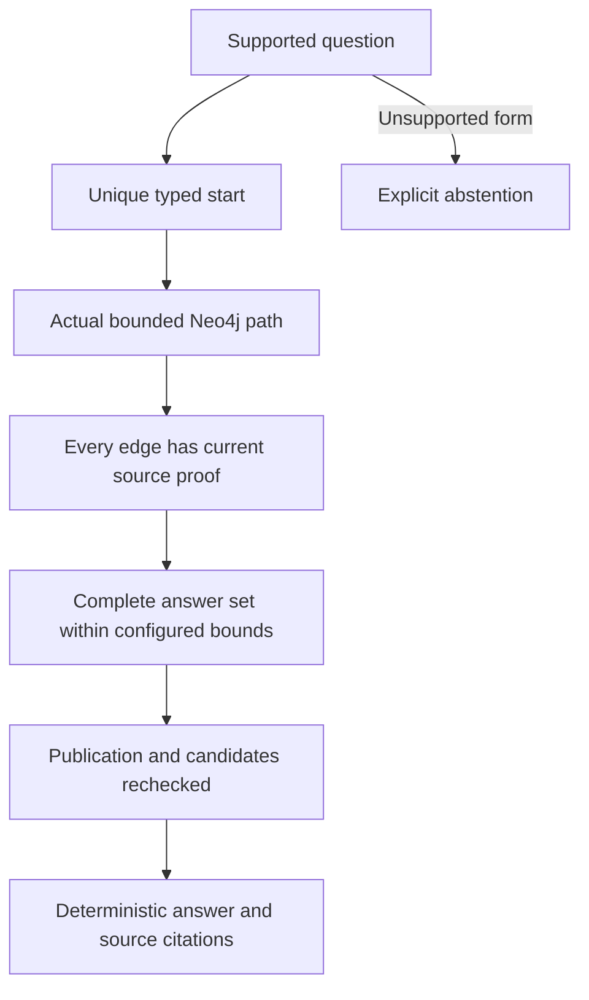

# Retrieval modes

All three modes use the same source set within a comparison. Their answerers are deterministic. The benchmark measures the complete implemented retrieval-and-answering pipeline; it does not compare interchangeable generative LLMs.

| Mode | Retrieval | Requirement for an answer | Typical failure |
|---|---|---|---|
| vector_only | Real local MiniLM and Neo4j vector index, top-k 5 | Frozen text rules recover supported evidence | Retrieved text contains evidence but the answer grammar does not support the question |
| graph_only | Typed, bounded Cypher paths from a uniquely resolved identity | Full path proof and publication revalidation | Unsupported question form, missing extracted relation or ambiguous start |
| hybrid_graph_vector | Vector candidates, entity expansion, graph paths and reciprocal rank fusion | The same graph-supported answer contract | More evidence is found but the graph answerer still abstains |

Vector indexing publishes a versioned build only after the required current chunks have valid vectors. Reindexing the same source publication returns the cached build. Model, dimension, source hashes and processing versions are part of consistency checks. Vector retrieval does not traverse factual graph relationships. Its cited output is still checked by deterministic text evidence rules. A known historical top-k 1 partial-set unsupported answer remains a limitation; the zero-unsupported results in the final comparisons apply to top-k 5 only.

Graph question interpretation recognizes finite patterns and emits a start type, relation sequence, answer type and rule ID. It is not a natural-language-to-Cypher model. For example, a supported cloud question emits MANAGES → USES → HOSTED_ON. The database supplies actual edge and node IDs. Evidence validation reconstructs every edge, checks direction/type and source state, detects competing branches and repeats publication checks before rendering the answer. Candidate overflow, conflicts, missing evidence, stale runs and unsupported forms fail closed or return explicit bounded errors.

The three-hop demo uses a qualified Priya identity so that a separate Lee Chen example exposes bare-name ambiguity. It returns Atlas, then its PostgreSQL instance, then AWS. The displayed graph path corresponds to three actual relationships. Citations include source evidence and offsets; retrieval similarity by itself is not a provenance proof.

Hybrid rank fusion combines evidence positions rather than treating vector scores as calibrated truth. It retains vector candidates as diagnostics even when graph interpretation rejects a question. In the final challenge its complete text-chain coverage was 86/128 (67.1875%) versus graph's 54/128 (42.1875%), but both had validated graph chains and correct positive answers for 54/128 (42.1875%). Hybrid-only correct answers: zero. It added embedding, retrieval and fusion latency. Historical ablations on the inspected aligned set found no quality loss after removing reranking, and zero positive answers after removing entity expansion.

For reproducible service calls use [DEMO_GUIDE.md](DEMO_GUIDE.md). [FINAL_EVALUATION.md](FINAL_EVALUATION.md) gives hop denominators, citation denominators and the limits of all reported percentages.
