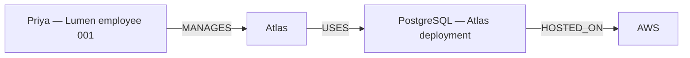

# Stage 5 report — corpus alignment and hybrid GraphRAG

Stage 5 implements source-only identity discovery, an isolated shared-corpus graph/vector build, and hybrid evidence fusion. It preserves Stage 1–4 data and reports. The aligned graph and hybrid answer all 96 answerable benchmark questions correctly, cite every required fact, and correctly abstain on all 26 unanswerable cases. The unchanged vector baseline keeps its earlier quality. Hybrid adds latency without improving the complete graph-only answers on this corpus.

**Stage 5 verdict: PASS for the implemented shared-corpus experiment and tested controls.** Both dataset splits were previously inspected; the results are not a blind generalization estimate. No Stage 6 work, paid model call, deployment, new GitHub repository, commit or push was introduced.

## Files and preservation

New runtime modules are in `app/aligned/`: source discovery, typed response/request models, versioned graph selection, sealed publication checks, hybrid candidate/evidence fusion and service ownership. `app/api/hybrid.py` exposes the hybrid endpoint plus explicit aligned graph/vector endpoints and isolated readiness. `scripts/build_aligned.py`, `coverage_stage5.py`, `verify_aligned.py`, `evaluate_stage5.py`, `verify_stage5_runtime.py`, `record_stage5.py`, `stage5_support.py` and `aligned.py` provide construction, audits, measurements, CLI access and verification. `compose.stage5.yml` uses its own volume and loopback ports. New unit/API/real-database tests and six requested documentation files complete the change.

The only changed pre-existing files are `.env.example`, `app/core/config.py`, `app/main.py`, `tests/unit/test_api.py`, `README.md`, `docs/PROJECT_ROADMAP.md` and `reports/README.md`. No old extraction, registry, source fixture, migration, dependency, vector runtime, graph runtime, grading rule or historical metric file changed. The complete hashed inventory is [FILE_MANIFEST.md](../reports/stage5/FILE_MANIFEST.md).

Before changes, Stage 5 archived all 187 shareable Stage 1–4 files and recorded exact nonsecret configuration and the historical graph hash in `history_freeze.json`/`frozen_stage4.zip`. The original graph retains SHA-256 `449ea1c1703fcecf7a75f2445102d9de19a5b7c8624fd41985675ce154a57a63`: 254 GraphNodes, 622 relationships, 93 source records, 110 runs and 92 vectors. Original curated fixture checks still verify 50 nodes, 91 relationships and 30 facts. Historical Stage 3 k=5 and Stage 4 graph-only 0% metrics remain intact.

## Coverage diagnosis and source-only construction

The original mismatch was accepted graph representation, not absent source documents. Vector indexing and graph ingestion already covered the same 92 source snapshots. The benchmark's new identities were outside the 27-entry reviewed registry; their statements therefore lacked accepted graph facts. Evaluation labels refer to 64 factual spans across 52 of those source documents. Missing source references were zero.

| Coverage measure | Historical | Aligned Stage 5 |
| --- | ---: | ---: |
| Vector-indexed source documents | 92 | 92 |
| Current graph-ingested source documents | 92 | 92 |
| Automatic accepted facts | 38 | 150 |
| Benchmark facts with graph support | 0/64 | 64/64 |
| Registry identities | 27 | 138 |
| Resolved answerable starts | 0/96 | 96/96 |
| Resolved starts across all questions | 0/122 | 108/122 |
| Documents with no supported facts | 77 | 1 |
| Missing labeled source references | 0 | 0 |
| Rejected candidates of all kinds | 133 | 8 |
| Rejected relationship candidates | 2 | 2 |
| Historical excluded automatic assertions | 41 | 0 |
| Facts invalidated by a changed document hash | 0 | 0 |

The 41 old exclusions concern historical runs/processing versions, not 41 changed content versions. Actual correction/invalidation behavior is exercised separately in real tests. `coverage_audit.json` includes exact source sets and every question's before/after status. It distinguishes source coverage, entity resolution, relationship extraction and expected unanswerable cases; it does not label upstream missing facts as a traversal failure.

Discovery creates **111 new source-context canonical identities** and reuses all 27 reviewed identities in the isolated database. It reads approved positive source statements only, records exact mention spans, scopes deployments by project and qualified people by employee context, and keeps similarly named/homonymous identities separate. No evaluation question, expected answer, gold ID, gold path or gold fact file enters construction. Existing Stage 2 relation grammar, independent provenance validation, stable IDs and bounded transactional publication remain in use. No held-out question was manually repaired.

The 150 accepted automatic assertions comprise 38 original and 112 extension assertions, including archive and incomplete-sandbox statements outside the 64 positive labels. Missing sandbox USES statements remain absent. The eight rejected candidates comprise two entity, two relationship and four non-asserted sentence decisions. All 111 discovered identities are persisted, there are no duplicate canonical IDs, and controlled identity tests observe zero incorrect merges. This is not external ground truth for indistinguishable real-world homonyms.

Fourteen starts remain unresolved: twelve deliberately unrecorded employment identities and two ambiguous bare names (Lee Chen and Jordan Vale). All are unanswerable cases, and all safely abstain. Answerable resolution is 100%; overall start resolution is 108/122 = 88.52%. Both intended ambiguous-person cases are detected, compared with one historically.

Backfill runs twice with identical results/assertion properties and no duplicates. Repeated MiniLM indexing reuses the same build. An independent audit checks every one of the 150 accepted facts against actual Neo4j endpoints, current original documents/chunks, exact quotes/offsets, processing/version identity and deterministic source proof: **150 passed, zero failures**. The aligned snapshot remains SHA-256 `1ae350c885144b61ecedeea545113624f3b9397e16e374dcc6fdd1e8da27e573`.

## Retrieval and reasoning behavior

The three modes use the same aligned 92 document versions and 92 chunks. Vector-only uses the frozen Stage 3 implementation. Graph-only uses the source-derived registry, actual schema-aware paths, per-edge provenance and complete-branch checks. Hybrid retrieves real vector chunks, discovers conservative exact entity candidates, obtains the same graph proof, and uses reciprocal-rank fusion to order evidence and validated paths. It keeps vector evidence, graph paths, fused evidence and final citations separate. Raw cosine similarity is not added to rule confidence. No vector similarity creates an edge.

Hybrid requires complete graph proof and has no vector-answer fallback. Unknown/ambiguous starts cannot be replaced by a nearby vector hit. Valid independent project branches may produce a complete answer set; contradictory functional assertions for one subject, missing known branches and invalid distinct branches abstain. A source-only publication seal detects deleted entire root branches or changed source versions before capture and again at revalidation. It only rejects incomplete builds; it never constructs an answer/path. The fixed evaluation publication must be rebuilt/reindexed and the API restarted after a source version change. Underlying source assertions/history remain intact.

Actual original-domain HTTP verification follows:



The aligned response contains one logical three-hop path, six actual automatic supporting citations, and fourteen raw prefix/full candidates. These are not fourteen distinct logical chains. Plain Priya remains ambiguous. The complete actual response is in `runtime_verification.json`.

## Fair quality comparison

The unchanged Stage 3 grader uses original source spans and complete normalized answer sets. Hybrid normalization unions actual graph/vector chunks, deduplicates the same source chunk, and keeps every required support. Stage 5 has no standalone curated relationships requiring citation remapping. Textual chain coverage is reported separately from actual validated graph-chain coverage. Both splits remain descriptive because they were inspected earlier.

| Measure | Frozen/new aligned vector k=5 | Aligned graph-only | Full hybrid |
| --- | ---: | ---: | ---: |
| One-hop accuracy | 35/36 = 97.22% | 36/36 = 100% | 36/36 = 100% |
| Two-hop accuracy | 9/36 = 25.00% | 36/36 = 100% | 36/36 = 100% |
| Three-hop accuracy | 1/24 = 4.17% | 24/24 = 100% | 24/24 = 100% |
| Answerable accuracy | 45/96 = 46.88% | 96/96 = 100% | 96/96 = 100% |
| Complete textual chain coverage | 46.88% | 100% | 100% |
| Validated graph-chain coverage | N/A | 100% | 100% |
| Required-evidence recall | 68.23% | 100% | 100% |
| Citation correctness | 57/57 = 100% | 191/191 = 100% | 191/191 = 100% |
| Answerable abstention | 53.13% | 0% | 0% |
| Correct unanswerable abstention | 26/26 = 100% | 26/26 = 100% | 26/26 = 100% |
| Unsupported answers at k=5 | 0 | 0 | 0 |

Graph/hybrid gains are +2.78, +75.00 and +95.83 percentage points by hop count, +53.125 points in answerable accuracy/complete-chain coverage and +31.7708 points in required-evidence recall. Overall accuracy including correct abstentions is 58.20% vector versus 100% graph/hybrid. All eight question tags and both splits are reported without cherry-picking in [SHARED_CORPUS_EVALUATION.md](SHARED_CORPUS_EVALUATION.md) and JSON. Every incorrect/abstained example is retained in `error_analysis.md` and full query rows.

The improvement includes document-driven identity/extraction coverage and structured navigation. It must not be attributed solely to hybrid ranking. This narrow, inspected synthetic corpus does not establish general-purpose GraphRAG superiority. The frozen vector answerer retains its documented Stage 3 top_k=1 partial-set failure; it was not modified or concealed. Zero unsupported counts above describe the standard k=5 experiment and listed tests, not an all-k guarantee.

## Ablations

| Configuration | Answerable accuracy | Complete textual chain | Validated graph chain | Unsupported |
| --- | ---: | ---: | ---: | ---: |
| Vector only | 46.88% | 46.88% | N/A | 0 |
| Graph only | 100% | 100% | 100% | 0 |
| Hybrid without entity expansion | 0% | 46.88% | 0% | 0 |
| Hybrid without graph reranking | 100% | 100% | 100% | 0 |
| Full hybrid, with expansion | 100% | 100% | 100% | 0 |

Removing expansion prevents every answerable benchmark start from linking into graph proof. Retrieved vector text still covers some complete chains, but the declared hybrid policy abstains. Full hybrid is also the “with entity expansion” treatment; it is not presented as an additional independent run. Removing reranking changes evidence order and timing without changing answer quality, because every required verified path/support remains. Full hybrid has no measured accuracy advantage over graph-only and costs more latency. Negative/null findings remain in `ablation_results.csv` and [HYBRID_ABLATIONS.md](HYBRID_ABLATIONS.md).

## Performance

The environment is Windows 11, Python 3.12.13, Neo4j Community 5.26.32, one physical/logical CPU and approximately 14.9 GB host RAM. The pinned CPU MiniLM uses normalized 384-dimensional embeddings and two inference threads; the real cosine vector index is ONLINE. Stage 5 runs alongside the idle preserved historical database. Benchmarks are sequential at concurrency one, top_k=5, max_hops=3, with explicit model/DB warm-up and no overlapping database tests or outages.

Final repeated-run end-to-end service latency over all 122 questions:

| Mode | p50 / p95 ms |
| --- | ---: |
| Frozen historical vector | 87.18 / 217.92 |
| New aligned vector | 91.91 / 243.93 |
| Aligned graph-only | 177.35 / 337.24 |
| Full hybrid | 279.27 / 637.68 |
| Hybrid without expansion | 88.47 / 212.79 |
| Hybrid without reranking | 288.55 / 682.69 |

Fresh local model startup/first inference took **14.63 seconds** using already cached weights, excluded from warm quantiles. First warmed original-domain requests took 429.27 ms vector, 188.42 ms graph, and 292.33 ms hybrid (wall time). No OS/page-cache flush was performed. After an actual database restart, the first recovered hybrid request took **20.02 seconds**; the subsequent three-hop request took **6.77 seconds**. Cold SQL/model behavior is materially slower than warm benchmark requests.

JSON preserves parsing, embedding, vector search, candidates, linking, graph capture, source proof, revalidation, fusion, generation and total phases by hop/split/tag. Graph capture/revalidation includes the publication seal. Raw candidates and discarded paths are recorded per request; benchmark answerable graph/hybrid queries capture 191 total raw prefix/full candidates and discard zero. These are repeated query counts, not unique corpus facts. The separate 150-fact audit provides source-proof coverage.

Eight concurrent HTTP requests at four workers returned eight distinct request IDs and correct cited answers, with p50/p95 **1018.81/1413.41 ms** on the repeated one-hop Atlas workload. This small local check does not establish high-concurrency production readiness. The hybrid configurations' minor timing differences are not a reliable ranking-speed advantage; the material finding is extra vector/fusion work without additional graph-only answer quality.

## Verification

The final complete suite contains **412 passing tests: 286 unit and 126 real integration, zero skipped, zero failed, zero errors**, including all 354 Stage 1–4 regression cases. New real scenarios cover source-derived homonyms, similar project aliases, direction/endpoint errors, missing intermediate/root branches, stale/failed/orphaned sources, source correction, contradictions, cycles, candidate bounds, corrupt vectors, prompt-like text, injection-like queries, concurrency, actual APIs and outage/recovery. Ruff lint, format and locked dependency checks pass. Detailed evidence is in `test_results.json`, local `reports/stage5-tests.xml`, and [STAGE5_SECURITY_TESTS.md](STAGE5_SECURITY_TESTS.md).

The live HTTP exercise starts a temporary Uvicorn process without DB/model preload, verifies all three aligned modes, the three-hop path, invalid-input 422s, concurrent request IDs, Stage 5 database stop, safe graph/hybrid 503s, API restart during the outage, and recovery. Process health stays 200, aligned readiness becomes 503, and historical database readiness stays 200. Startup to health took 3.08 seconds. The temporary API/model process tree is stopped and both persistent databases remain healthy; no volume was removed.

Two final full evaluations match every non-timing per-question field across all five configurations: **610 exact query comparisons**, including source IDs, vector scores, paths, citations and fusion order. The final runtime/source-manifest hashes remain frozen. The earlier development run and initial freeze remain recorded because final source-publication/candidate-boundary controls superseded them, without gold-based source/identity repairs. Historical file/settings checks and both database snapshots pass again after verification.

## Reproduction and remaining limits

See README for the isolated Compose/backfill/index setup. Stop the API before rebuilding, retain all volumes, and rerun the full source audit for a new build's run-specific snapshot. In PowerShell, after building/indexing:

```powershell
uv run ruff check .
uv run ruff format --check .
uv lock --check
uv run pytest --run-integration -q -x --tb=short --junitxml=reports/stage5-tests.xml
uv run python -m scripts.coverage_stage5
uv run python -m scripts.verify_aligned
uv run python -m scripts.evaluate_stage5
New-Item -ItemType Directory -Force .pytest_cache/stage5-final-first | Out-Null
Copy-Item reports/stage5/*metrics.json,reports/stage5/performance.json .pytest_cache/stage5-final-first
uv run python -m scripts.evaluate_stage5
# Run sequentially after other database work.
uv run python -m scripts.verify_stage5_runtime
uv run python -m scripts.record_stage5
```

No implementation blocker remains for this measured Stage 5 scope. Broader claims are limited by the previously inspected synthetic benchmark, finite grammar, controlled contextual identity assumptions, fixed-publication availability, retained history, explicit refresh/rebuild requirements, non-atomic final revalidation and local unauthenticated deployment assumptions. The frozen vector baseline's known small-k partial-set limitation remains. Independently unseen data and stronger load/freshness work would be needed before broader quality or production claims. Stage 6 has not started.
