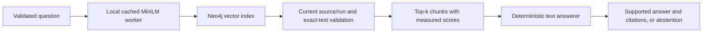

# Vector-only baseline architecture

This Stage 3 baseline embeds original document chunks with real, local Sentence Transformers inference. Neo4j Community performs vector similarity search. A deterministic local grammar answers from the returned text. It is not an LLM. Graph retrieval and GraphRAG comparisons remain future work.

The runtime modules are in `app/vector/`. They never import the entity registry, curated graph records, extraction pipeline, or evaluation package. Retrieval executes `db.index.vector.queryNodes` followed by node-only metadata matches. It does not follow factual edges, MENTIONS, or even structural PART_OF edges. Source metadata is sufficient to resolve immutable document/chunk ownership.

## Model lifecycle

`sentence-transformers/all-MiniLM-L6-v2` is pinned to upstream commit `1110a243fdf4706b3f48f1d95db1a4f5529b4d41`. The model produces 384-element float vectors. Document and question embeddings use the same CPU inference path and L2 normalization. Every returned vector must have 384 finite numeric elements and unit norm within 0.0001. Model identity, revision, normalization policy, token limit, and installed inference-package versions contribute to the embedding version.

An explicit preparation command downloads public weights using internet access. Inference uses `local_files_only=True` and offline environment settings; it cannot silently download weights, use paid inference, or substitute fabricated embeddings. One supervised child worker loads the model once for each API/CLI process. CPU inference uses two threads. A lock serializes inference, with a bounded queue wait. Startup and inference have separate deadlines; a timed-out worker is terminated and may be restarted on a later request. FastAPI owns and closes its worker during lifespan shutdown. Liveness can start while dependencies are unavailable.

The actual tokenizer counts all tokens, including special tokens. Text exceeding 256 tokens is rejected before inference. Original chunks and offsets are preserved; nothing is silently truncated or rewritten. If future inputs exceed the limit, choose reviewed Stage 2 chunk options and re-ingest, then index that processing version. Batches contain at most 32 texts.

Default deadlines are 180 seconds for cold model startup, 30 seconds for inference/queue waiting, and 20 seconds for each vector metadata/search query. The existing database readiness query keeps its shorter five-second deadline. Slow Windows first imports and cold Neo4j query compilation are measured separately from warm queries.

## Answer generation

The answerer parses complete positive sentences in retrieved text into temporary, source-cited statements. It then evaluates an explicitly supported question grammar over those statements. All of this happens in memory after vector ranking. It does not query or write a graph, expand the candidate set, use a registry, or rerank chunks using extracted relations.

Supported forms cover management, employment, ownership, project technology, scoped hosting, and selected two-/three-step combinations. Technology instances are keyed by product text plus explicit project text, preventing a database name alone from joining Atlas and Atlas East. Product/cloud lexical equivalents are a small general vocabulary, not corporate identity mappings. Qualified person names require exact qualification. Unknown wording, missing links, contradictory single-valued statements, and unresolved identity cause abstention. Every supported step contributes an exact quote and absolute document offsets to citations.

This grammar is deliberately limited. It is not general natural-language understanding, calibrated entailment, or an exhaustive-world guarantee. The answerer cannot know about relevant documents the retriever did not return. Multiple-intermediate questions can therefore produce incomplete answer sets when an entire branch is absent; the evaluator counts those errors. Retrieval coverage and answer correctness must be reported separately. Future generators may implement the same answer interface, but no paid adapter is enabled.

## API and safe failures

`POST /api/v1/rag/vector/query` accepts `question` (1–1000 characters, nonblank, readable) and integer `top_k` (1–10, default 5). Extra properties and booleans/floats for top_k are rejected. A question exceeding the token budget returns 422. Dependency, model, vector schema, and provenance failures return safe 503 errors, never a successful fabricated abstention. Existing request IDs and error redaction apply. No Cypher endpoint is exposed.

Successful responses include the answer or abstention reason, actual Neo4j scores, retrieved text and source/version metadata, exact citations, corpus build, embedding version, and measured embedding/retrieval/generation/end-to-end service timings. These are service timings; network and client serialization overhead are outside that timer. `/ready` retains its Stage 1 database-connectivity meaning; it is not a claim that weights or a vector corpus are ready. Use the vector status CLI and an actual vector query to verify those dependencies.

Neo4j's cosine index scores lie in [0,1]. They rank similarity, not answer correctness or truth probability.
