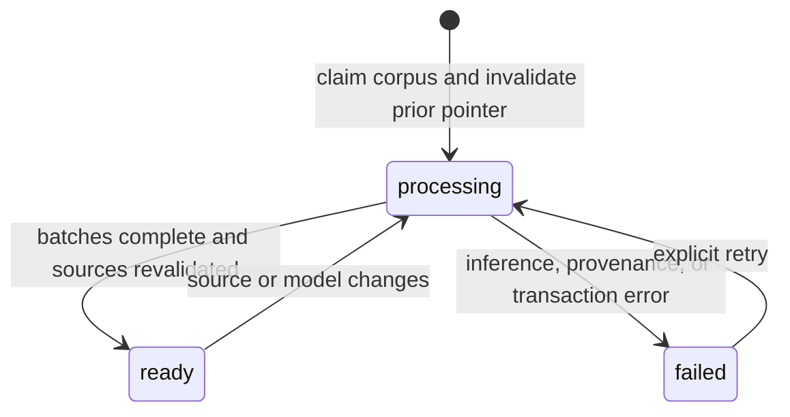

# Vector indexing and source eligibility

Stage 3 consumes the published automatic Document/Chunk snapshots from Stage 2. It also adds a versioned, explicitly synthetic benchmark extension in `data/fictional/stage3_corpus.json`. Benchmark documents pass through the same Stage 2 source lifecycle. Their unfamiliar names need not be accepted by the extraction registry: vector retrieval uses the original text, independently of accepted graph facts.

The original 12 curated documents are indexed through their Stage 2 automatic snapshots, preserving `original_document_id`. They are not indexed a second time through the manual fixture nodes. The four Stage 2 local documents remain included. Old processing runs and diagnostic/test sources are excluded by an explicit corpus source list.

Benchmark source filenames such as `stage3/s01-source-1.txt` are logical names for entries in the checked-in JSON corpus, not separate files on disk. Resolve them to that corpus's matching `documents[].id`. Their immutable source text is also retained in the Document snapshot.

## Schema and preservation

Migration `004_chunk_vectors.cypher` creates three operational uniqueness constraints and `chunk_minilm_cosine`, a 384-dimensional cosine node vector index on `ChunkEmbedding.embedding`. Neo4j 5.26 Community supports ordinary lists of floats; no Enterprise VECTOR property type, APOC, Graph Data Science, or hosted embedding feature is required. [Neo4j 5 vector index documentation](https://neo4j.com/docs/cypher-manual/5/indexes/search-indexes/vector-indexes/) describes the supported DDL and query procedure.

Each `ChunkEmbedding` is a separate operational record containing the original canonical chunk ID, document/source/run IDs, hashes, offsets, original text, processing version, model, embedding version, and float-list embedding. It is not a duplicate Chunk node. Canonical Document/Chunk labels and properties, extraction assertions, curated fingerprints, and original IDs are unchanged. The separate record is necessary because Stage 1–2 publication compares complete immutable source payloads.

`VectorCorpus` is a named publication pointer. `VectorBuild` records its source manifest, configuration, signature, state, safe failure category, timestamps, and summary. A build ID hashes the sorted exact canonical records and model/configuration version. Embedding record IDs hash build and chunk IDs. Equal inputs reuse the same identities. Updated content/model/configuration creates a different build; no unrelated graph data is deleted.



A write-locked corpus claim with a renewable 300-second lease prevents simultaneous publication. Batches use managed Neo4j transactions with configured retry behavior and parameterized data. A final transaction re-reads canonical sources, compares the complete expected embedding set and vector validity, and publishes atomically. Failed or interrupted physical batches remain inspectable but have no ready pointer. An unchanged repeat checks stored provenance/vectors and returns the published summary. Schema migration remains a single-writer maintenance operation.

## Read eligibility and Neo4j 5.26 filtering

Before retrieval, the index must be ONLINE with the exact label, property, dimension, and similarity configuration. The published build must match the current embedder version. Returned vectors must belong to that build. For each source, ready status, equal current/desired ingestion pointers, ready run, document ownership, processing version, and matching content hashes are mandatory. Python recomputes document/chunk hashes and compares exact original slices against indexed metadata. Missing chunks and stale source versions are excluded. Corrupted returned source evidence produces an explicit infrastructure error.

The vector query also checks the active corpus/build pointer inside its metadata match and rechecks publication after search. A rebuild racing with the request produces a safe availability error, not an answer from an invalidated build. Current ingestion publication still defines source freshness at the time of the read; no claim is made about edits occurring after a response.

Neo4j 5.26's vector procedure does not provide metadata prefiltering. On this small baseline, the candidate request covers all physical embedding records (maximum 10,000), then filters current build/source metadata before taking top-k. Ranking remains exclusively the vector score, with chunk ID as a deterministic tie-break. This prevents old/failed vectors consuming the candidate budget. It deliberately sacrifices scaling efficiency; no production scalability claim is made. The backend is still Neo4j's real approximate vector index, and it can return fewer candidates than requested. This is not graph-assisted ranking or a Python cosine-search replacement.

The source-of-truth boundary is the last successfully refreshed ingestion. There is no filesystem watcher or distributed transaction spanning NTFS and Neo4j. Refresh edited/deleted files through Stage 2 first, then reindex. Retrieval immediately excludes an old source once its current publication changes, even before reindexing; unaffected sources remain eligible. No system can detect an unannounced filesystem edit purely by reading its database snapshot.

## Windows PowerShell workflow

```powershell
Set-Location <research-workspace>
uv sync --locked
uv run python -m scripts.setup_env
docker compose --progress plain up -d --wait
uv run python -m scripts.graph migrate
uv run python -m scripts.graph load
uv run python -m scripts.vector prepare-model
uv run python -m scripts.vector index
uv run python -m scripts.vector index  # unchanged repeat reports cached=true
uv run python -m scripts.vector status
uv run python -m scripts.vector query --question 'Which cloud platform hosts the database used by the project managed by Priya?' --top-k 5
uv run python -m scripts.serve
```

The model preparation command needs internet on the first download. Normal inference and Neo4j retrieval run locally. `uv.lock` pins dependencies; the upstream model revision is pinned separately. Never commit `.env` or the local model cache. The index command is restricted to development mode. To refresh a removed/corrupt local file, use `scripts.ingest ingest filename` so its prior publication is invalidated. Restore/re-ingest as appropriate before rebuilding a complete corpus.

```powershell
$body = @{ question = 'Which database does Project Atlas use?'; top_k = 5 } | ConvertTo-Json
Invoke-RestMethod -Method Post -Uri http://127.0.0.1:8000/api/v1/rag/vector/query -ContentType 'application/json' -Body $body
```
