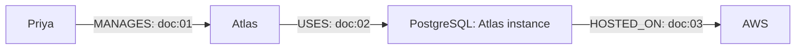

# GraphRAG for Multi-Hop Question Answering

Stage 6 adds a new controlled challenge, repeatable source-only builds, bounded load tests and actual outage/recovery measurements. The retrieval implementation and Stage 1–5 evidence remain preserved. See the [Stage 6 report](../../docs/STAGE6_REPORT.md), [evaluation protocol](../../docs/STAGE6_EVALUATION_PROTOCOL.md) and [generalization audit](../../docs/STAGE6_GENERALIZATION.md). This is a local controlled evaluation, not an independent external benchmark. Hosted GitHub CI is UNVERIFIED.

Project 3 in an AI engineering portfolio. Stages 1–4 built the evidence-backed graph, automatic extraction, local MiniLM vector baseline, and bounded graph-only retrieval. Stage 5 adds source-only entity discovery, an isolated aligned corpus, and hybrid vector/graph evidence with deterministic grounded answers.

Example: Priya manages Atlas. Atlas uses a PostgreSQL instance. That instance is hosted on AWS. Each statement comes from a different fictional document. The graph can verify the three-hop path to AWS.

The historical Stage 4 graph result remains 0% at every hop count because its frozen registry lacked the benchmark identities. Stage 5 uses the same 92 source versions, discovers 111 identities from source text, and validates 150 automatic facts in a separate database. Aligned graph-only and hybrid accuracy is 100% at all three hop counts; the unchanged vector baseline retains 97.22%/25.00%/4.17%. Hybrid adds latency without improving graph-only accuracy here. Both dataset splits were previously inspected, so this is not a blind generalization result. See the [Stage 5 report](../../docs/STAGE5_REPORT.md), [shared-corpus comparison](../../docs/SHARED_CORPUS_EVALUATION.md), and preserved [Stage 4 report](../../docs/STAGE4_REPORT.md).

Stage 2 uses deterministic rules and a reviewed fictional alias registry. It makes no paid provider calls. See [automatic extraction](../../docs/AUTOMATIC_EXTRACTION.md), [entity resolution](../../docs/ENTITY_RESOLUTION.md), [provenance validation](../../docs/PROVENANCE_VALIDATION.md), [measured evaluation](../../docs/EXTRACTION_EVALUATION.md), and the [Stage 2 report](../../docs/STAGE2_REPORT.md).

## Windows PowerShell setup

Requirements: Python 3.12 or newer, [uv](https://docs.astral.sh/uv/getting-started/installation/), and Docker Desktop using Linux containers. Open Docker Desktop and wait until its engine is running.

```powershell
Set-Location <research-workspace>
uv sync --locked
uv run python -m scripts.setup_env
docker compose --progress plain up -d --wait
uv run python -m scripts.graph migrate
uv run python -m scripts.graph load
uv run python -m scripts.graph validate
uv run python -m scripts.serve
```

`setup_env` creates an ignored `.env` with a random local password and never prints it. An existing `.env` is left unchanged. The example password is a placeholder and application validation rejects it. Use a local password with at least 12 characters and no whitespace, `/`, or `$`. Neo4j also enforces the minimum length.

The API normally runs at `http://127.0.0.1:8000`. Interactive API docs are at `/docs`. `API_HOST` and `API_PORT` control the server started by `scripts.serve`.

In another PowerShell window:

```powershell
Invoke-RestMethod http://127.0.0.1:8000/health
Invoke-RestMethod http://127.0.0.1:8000/ready
Invoke-RestMethod http://127.0.0.1:8000/api/v1/ready
```

`/health` returns 200 while the process is alive. `/ready` executes a bounded query against the configured database and returns 503 during an outage. Both also exist under `/api/v1`. Request IDs appear in response headers and safe error bodies.

## Local Neo4j

Open `http://localhost:7474` in your browser. Connect using `bolt://localhost:7687`, user `neo4j`, and the password from your local `.env`. Use your editor to read the password locally; do not paste credentials into reports or commits.

Both published ports bind only to `127.0.0.1`. The Compose project has a dedicated named data volume. The database is Community Edition, pinned to `5.26.32-community` from the 5.26 LTS line. The official 6.x driver supports Neo4j 5.x ([compatibility](https://neo4j.com/docs/python-manual/current/install/), [release notes](https://neo4j.com/release-notes/)). Python package versions are recorded exactly in `uv.lock`.

If ports are occupied, change these values in `.env` before starting Compose:

```dotenv
NEO4J_HTTP_PORT=17474
NEO4J_BOLT_PORT=17687
NEO4J_URI=bolt://127.0.0.1:17687
API_PORT=18000
```

The host ports and driver URI must agree. Inside the container Neo4j still uses 7474 and 7687. Container listeners allow Docker forwarding; the published host ports remain local. Do not change them to `0.0.0.0`.

Stop the API with Ctrl+C. Stop Neo4j with:

```powershell
docker compose stop neo4j
# Or remove the project container and network, preserving its data volume:
docker compose down
```

Changing `NEO4J_PASSWORD` does not change the password in an existing data volume. See [troubleshooting](#troubleshooting).

The container health check probes HTTP with Bash builtins. It avoids starting Java `cypher-shell` processes on every probe; timed-out Java probes previously accumulated orphan processes on this machine. Application `/ready` still performs a real authenticated database query. Container health alone is not integration verification.

## Automatic document ingestion (Stage 2)

After setup/migrations and loading the Stage 1 fixture:

```powershell
$atlas = uv run python -m scripts.ingest ingest atlas.txt | ConvertFrom-Json
uv run python -m scripts.ingest summary $atlas.source_id
uv run python -m scripts.ingest validate $atlas.source_id
uv run python -m scripts.ingest ingest cedar.md
uv run python -m scripts.ingest ingest conflicting-hosting.txt
uv run python -m scripts.ingest ingest review-required.md
uv run python -m scripts.ingest fixtures
uv run python -m scripts.ingest list
uv run python -m scripts.ingest rejections $atlas.source_id
uv run python -m scripts.ingest conflicts $atlas.source_id
uv run python -m scripts.verify_ingestion
uv run python -m scripts.evaluate_extraction
```

TXT and Markdown inputs must be relative filenames below `data/fictional`. The CLI rejects outside paths, URL inputs, links, invalid encoding, and oversized files. No ingestion or graph mutation HTTP endpoint exists. The example Cedar file contains a second, distinct person named Priya. The conflict file records a hosting claim for review; it does not replace curated evidence.

Each source has immutable content-hash snapshots. Chunk offsets refer to original Unicode text. Accepted facts store exact evidence spans, rules, versions, and document/chunk references. Ambiguous identities, negations, and unsupported wording are rejected. Runs move from pending through processing to ready or failed. Only current-version facts belonging to a current ready source/run are eligible. Failed batches and stale history are physically retained for inspection but hidden by the eligibility query.

Re-ingesting unchanged input is idempotent. Re-ingesting a correction hides the old source version and retains independent evidence. A failed read of a previously ingested local filename also invalidates that source until a successful refresh. There is no filesystem watcher: refresh edited or removed sources through the CLI. See [visibility and consistency limits](../../docs/AUTOMATIC_EXTRACTION.md#lifecycle-and-visibility).

The labeled extraction set has 53 synthetic documents and separate calibration/held-out cases. The report gives observed precision, recall, canonical assignments, unsupported facts, and provenance accuracy. Those figures describe this controlled fictional domain, not arbitrary real-world extraction.

## Vector-only baseline (Stage 3)

The baseline uses real `sentence-transformers/all-MiniLM-L6-v2` inference on CPU and an ONLINE 384-dimensional cosine index in Neo4j Community 5.26.32. It indexes 92 canonical chunks from the existing 16-document corpus plus 76 explicitly synthetic benchmark documents. Embedding records preserve original chunk IDs and every Stage 1–2 extraction property. Retrieval checks current source publication and exact text/hash provenance, using no factual relationships or entity registry.

```powershell
uv sync --locked
uv run python -m scripts.graph migrate
uv run python -m scripts.vector prepare-model  # first download requires internet
uv run python -m scripts.vector index
uv run python -m scripts.vector index          # unchanged repeat is cached
uv run python -m scripts.vector status
uv run python -m scripts.vector query --question 'Which database does Project Atlas use?' --top-k 5
uv run python -m scripts.evaluate_baseline
uv run python -m scripts.benchmark_vector
uv run python -m scripts.serve
```

```powershell
$body = @{ question = 'Which database does Project Atlas use?'; top_k = 5 } | ConvertTo-Json
Invoke-RestMethod -Method Post -Uri http://127.0.0.1:8000/api/v1/rag/vector/query -ContentType 'application/json' -Body $body
```

The deterministic generator is not an LLM. It supports a defined question/sentence grammar, cites every supported step, and abstains on missing evidence. Infrastructure failures return explicit errors. The 122-question synthetic dataset measures retrieval evidence separately from answer generation at k=1,3,5,10. Both calibration and held-out splits were inspected during development; no blind generalization claim is made.

See [Stage 3 results](../../docs/STAGE3_REPORT.md), [architecture](../../docs/VECTOR_BASELINE_ARCHITECTURE.md), [indexing](../../docs/VECTOR_INDEXING.md), [evaluation definitions](../../docs/BASELINE_EVALUATION.md), and [integrity checks](../../docs/BASELINE_INTEGRITY.md). Raw measured results are in [reports/stage3](../../reports/stage3/baseline_metrics.json). Run `scripts.verify_vector_runtime` sequentially after database tests: it deliberately stops and restores only this project's Neo4j service.

## Repository map

| Location | Purpose |
| --- | --- |
| `app/main.py`, `app/api/` | Application lifespan, request IDs, safe errors, health/readiness |
| `app/core/` | Environment settings and JSON logs with redaction |
| `app/db/` | Official Neo4j driver and explicit migration runner |
| `app/models/`, `app/graph/` | Strict Pydantic fixtures, schema directions, fixed validation queries |
| `app/repositories/`, `app/services/` | Atomic fixture loading and graph integrity checks |
| `app/extraction/`, `app/evaluation/` | Local document loading, chunking, extraction, resolution, validation, and measured evaluation |
| `app/vector/`, `app/api/vector.py` | Local MiniLM worker, immutable-source indexing, vector-only retrieval, text answerer, and query API |
| `app/schemas/` | Reserved package for future authenticated API contracts |
| `data/fixtures/`, `data/evaluation/` | Fictional source corpus, facts, and expected evidence paths |
| `migrations/` | Ordered, checksum-tracked Cypher schema files |
| `scripts/` | Environment setup, server, migration/load/validate/reset, runtime verification |
| `tests/unit/`, `tests/integration/` | Database-free tests and explicit real Neo4j tests |
| `docs/`, `infra/`, `reports/` | Design, operating notes, and verification evidence |

## Graph and fixtures

The unchanged Stage 1 fixture contains **50 graph nodes** and **91 relationships**. Nodes include 26 entities, 12 documents, and 12 source chunks. Relationships include 30 factual edges and 61 evidence/structure edges. Stage 2 source snapshots, automatic assertions, and ingestion metadata are counted separately.



The corpus has 3 organizations, 8 people, 6 projects, 6 technology instances, and 3 cloud platforms. Atlas East uses a separate PostgreSQL instance hosted on Azure. Two Lee Chen records have different employee scopes. Ivo and Una have no recorded employment or management facts. Nine evaluation cases cover one, two, and three hops, multiple documents, missing information, and ambiguous names.

See [architecture](../../docs/ARCHITECTURE.md), [schema](../../docs/GRAPH_SCHEMA.md), [provenance](../../docs/DATA_PROVENANCE.md), [verification report](../../docs/STAGE1_REPORT.md), and [roadmap](../../docs/PROJECT_ROADMAP.md).

## Migrations and repeatable loading

```powershell
uv run python -m scripts.graph migrate
uv run python -m scripts.graph migrate
uv run python -m scripts.graph load
uv run python -m scripts.graph load
uv run python -m scripts.graph validate
```

Migrations are ordered by their three-digit filename prefix. The database stores a version and checksum after each successful file. Existing versions are skipped; edited applied migrations and missing/out-of-order versions fail. Each schema statement uses `IF NOT EXISTS`, so a partially failed file can be rerun. Run one migration process at a time. Migration files contain trusted DDL separated by semicolons; this deliberately small runner does not parse arbitrary Cypher scripts.

Loading uses one transaction, stable IDs, a fixture lock, and collision checks. Existing identical records are retained. Changed snapshots fail and roll back. Loading never clears graph data. Rebuilding JSON is optional: `uv run python -m scripts.build_fixtures`. Tests verify that the generated content matches the checked-in files.

To remove **only this fictional fixture**, explicitly name it and use the development environment:

```powershell
uv run python -m scripts.graph reset --confirm-fixture fixture:corporate-v1
uv run python -m scripts.graph load
```

Reset refuses to remove nodes that have external relationships. It preserves schema, migration records, and unrelated data. Treat reset as destructive: the typed fixture ID is its confirmation. There is no automatic volume deletion command. An incompatible edited fixture should use reviewed new IDs or an explicitly confirmed development reset.

## Sample Browser queries

Use IDs instead of ambiguous display names. These are trusted local validation queries.

```cypher
// Two hops: Priya -> Atlas -> PostgreSQL (Atlas instance)
MATCH p=(:Person {id: 'person:priya'})-[:MANAGES]->(:Project)-[:USES]->(:Technology)
WHERE all(r IN relationships(p) WHERE r.fixture_id = 'fixture:corporate-v1')
RETURN p;

// Three hops: Priya -> Atlas -> PostgreSQL (Atlas instance) -> AWS
MATCH p=(:Person {id: 'person:priya'})-[:MANAGES]->(:Project)
        -[:USES]->(:Technology)-[:HOSTED_ON]->(:Platform)
WHERE all(r IN relationships(p) WHERE r.fixture_id = 'fixture:corporate-v1')
RETURN p, [r IN relationships(p) | r.source_document_id] AS source_documents;

// Resolve one factual edge to the original source text
MATCH ()-[r:MANAGES {id: 'fact:001'}]->()
MATCH (c:Chunk {id: r.source_chunk_id})-[:PART_OF]->(d:Document {id: r.source_document_id})
RETURN r.id, r.quote, c.id, c.start, c.end, d.id, d.title, d.text;

SHOW CONSTRAINTS;
SHOW INDEXES;
```

There is no API for running Cypher. Application and maintenance code pass data as query parameters. Dynamic labels/types are selected only from validated enums or fixed internal constants.

## Graph-only questions (Stage 4)

The graph endpoint uses the same frozen source corpus and existing registry. Plain Priya is ambiguous; qualify the employee identity. It uses no vector fallback, model, or evaluation answers.

```powershell
uv run python -m scripts.graph_rag plan --question 'Which project does Morgan manage?'
uv run python -m scripts.graph_rag link --question 'Which project does Priya manage?'
uv run python -m scripts.graph_rag query --question 'Which cloud platform hosts the database used by the project managed by Priya (Lumen employee 001)?' --max-hops 3
$graphQuestion = @{
  question = 'Which cloud platform hosts the database used by the project managed by Priya (Lumen employee 001)?'
  max_hops = 3
} | ConvertTo-Json
Invoke-RestMethod -Method Post http://127.0.0.1:8000/api/v1/rag/graph/query -ContentType 'application/json' -Body $graphQuestion
```

The example returns AWS with actual source citations and the MANAGES → USES → HOSTED_ON path. Input is limited to 1,000 characters and three factual hops. Defaults cap total prefix/full candidates at 128, answers at ten, each query at ten seconds, and the request at twenty seconds. Missing, ambiguous, conflicting, or incomplete evidence causes abstention. `GRAPH_QUERY_TIMEOUT`, `GRAPH_REQUEST_TIMEOUT`, `GRAPH_MAX_CANDIDATES`, and `GRAPH_MAX_ANSWERS` configure bounded limits. The approved source/version manifest is `data/runtime/graph_corpus_v1.json`; adding new ingestion sources does not automatically authorize them for graph questions.

See [architecture](../../docs/GRAPH_RETRIEVAL_ARCHITECTURE.md), [entity linking](../../docs/ENTITY_LINKING.md), [reasoning and provenance](../../docs/MULTIHOP_REASONING.md), [evaluation](../../docs/GRAPH_EVALUATION.md), and [adversarial tests](../../docs/GRAPH_SECURITY_TESTS.md). Exact freeze files and new results are in `reports/stage4/`; Stage 3 artifacts are preserved.

## Shared corpus and hybrid retrieval (Stage 5)

Stage 5 uses `compose.stage5.yml`, its own named volume, and loopback ports 17475/17688. The historical database stays on 7474/7687. The same existing local password initializes the separate volume; it is never printed. Stop the API before rebuilding the aligned corpus so a running service cannot keep an old registry/publication in memory.

```powershell
docker compose -f compose.stage5.yml --progress plain up -d --wait
uv run python -m scripts.build_aligned backfill
uv run python -m scripts.build_aligned index
uv run python -m scripts.coverage_stage5
uv run python -m scripts.verify_aligned
uv run python -m scripts.serve
```

Backfill prepares the registry from approved source sentences, reuses Stage 2 extraction/proof/lifecycle writes, and runs two idempotency passes. Indexing uses the same source snapshots/chunks and pinned local MiniLM. Source documents, historical metrics and the old graph are preserved. Generated Stage 5 registry/corpus manifests live in `data/runtime/`; they contain no gold answers, question IDs or gold fact/path IDs. A failed/changed source or deleted sealed assertion makes the fixed publication unavailable until it is rebuilt, indexed and the API restarted.

```powershell
uv run python -m scripts.aligned --mode vector_only --question 'Which database does Project Atlas use?'
uv run python -m scripts.aligned --mode graph_only --question 'Which project does Morgan manage?'
uv run python -m scripts.aligned --mode hybrid_graph_vector --question 'Which cloud platform hosts the database used by the project managed by Priya (Lumen employee 001)?' --top-k 5 --max-hops 3
$hybridQuestion = @{
  question = 'Which cloud platform hosts the database used by the project managed by Priya (Lumen employee 001)?'
  top_k = 5
  max_hops = 3
} | ConvertTo-Json
Invoke-RestMethod -Method Post http://127.0.0.1:8000/api/v1/rag/hybrid/query -ContentType 'application/json' -Body $hybridQuestion
Invoke-RestMethod http://127.0.0.1:8000/api/v1/rag/aligned/ready
```

The three aligned endpoints are `/api/v1/rag/aligned/vector/query`, `/api/v1/rag/aligned/graph/query`, and `/api/v1/rag/hybrid/query`. Historical endpoints retain their original corpus/runtime. Hybrid keeps vector evidence, exact entity candidates, validated graph paths, fused evidence, citations, reasons, request IDs and timings separate. RRF orders evidence; it never turns similarity into a fact. Hybrid requires complete graph proof and cannot fill a missing edge from a vector answer candidate. Bare Priya remains ambiguous.

The request limit is 1,000 characters, top_k=1–10 and max_hops=1–3. Existing graph bounds still apply; `HYBRID_REQUEST_TIMEOUT` defaults to sixty seconds. `STAGE5_NEO4J_URI`, `STAGE5_BOLT_PORT`, and `STAGE5_HTTP_PORT` control the separate instance and must agree. Source freshness requires explicit versioned backfill/index publication; there is no filesystem watcher.

For a clean isolated rebuild while retaining both existing volumes, choose a new Compose project and free ports in the current PowerShell process:

```powershell
$env:STAGE5_HTTP_PORT = '27475'
$env:STAGE5_BOLT_PORT = '27688'
$env:STAGE5_NEO4J_URI = 'bolt://127.0.0.1:27688'
$env:STAGE5_COMPOSE_PROJECT = 'graphrag-stage5-rebuild'
docker compose -f compose.stage5.yml -p graphrag-stage5-rebuild --progress plain up -d --wait
uv run python -m scripts.build_aligned backfill
uv run python -m scripts.build_aligned index
```

Do not point Stage 5 at the historical URI or delete a volume to rebuild. Evaluation freezes and exact full-state hashes are run-specific; a new build can have new creation timestamps while retaining stable source/fact identities. Repeat the source audit for its new snapshot. See [coverage audit](../../docs/STAGE5_COVERAGE_AUDIT.md), [hybrid architecture](../../docs/HYBRID_ARCHITECTURE.md), [ablations](../../docs/HYBRID_ABLATIONS.md), and [security checks](../../docs/STAGE5_SECURITY_TESTS.md).

## Tests and verification

```powershell
uv run ruff check .
uv run ruff format --check .
uv run pytest tests/unit -q
uv run pytest tests/integration --run-integration -q
uv run pytest --run-integration -q
uv run python -m scripts.graph validate
uv run python -m scripts.verify_ingestion
uv run python -m scripts.evaluate_extraction
uv run python -m scripts.verify_runtime
```

Without `--run-integration`, integration tests are explicitly skipped. With it, connection failures fail the suite. Unit tests alone do not prove the database works. Integration tests load the named fictional fixture and rerun migrations; use the local development database. A corruption test rolls back its own deliberate changes.

`verify_runtime` starts a real temporary API process, stops **this Compose project's Neo4j service**, checks health=200/readiness=503 and failed ingestion, restarts Neo4j, and checks readiness=200 and successful ingestion/provenance. It restores the service on failure and stops its temporary API. Run it sequentially after database tests, never concurrently with them. Results are written to `reports/runtime-verification.json`. JUnit reports can be generated with `--junitxml=reports/unit.xml` or `--junitxml=reports/integration.xml`.

## Troubleshooting

| Symptom | Action |
| --- | --- |
| Docker pipe/daemon error | Open Docker Desktop, select Linux containers, then retry `docker info`. |
| Port already allocated | Change host ports and `NEO4J_URI` together in `.env`. Recreate this Compose service. |
| Readiness 503 | Run `docker compose ps` and `docker compose logs --tail 80 neo4j`. Confirm URI, database, and the credentials used when the volume was initialized. |
| Authentication fails after editing `.env` | Restore the volume's existing password, or change it through Neo4j Browser while authenticated. Environment changes only set the initial password on an empty volume. |
| Password rejected | Generate `.env` with `scripts.setup_env`, or set a non-placeholder password matching the documented rules. |
| Fixture snapshot conflict | Restore the original fixture; use a reviewed new dataset identity or explicitly reset the development fixture. |
| Migration checksum changed | Restore the applied migration and add a new numbered migration for schema changes. |
| Import timeout on a very slow machine | Increase `NEO4J_IMPORT_TIMEOUT` (default 60 seconds, maximum 300), then retry. Imports roll back atomically. Readiness keeps the shorter query timeout. |
| `uv` copies files instead of hardlinking | Different drives can cause this harmless fallback. `uv sync --locked --link-mode copy` selects copying explicitly. |

Stage 4 verification commands (run the outage check after other database work):

```powershell
uv run pytest --run-integration -q --tb=short --junitxml=reports/stage4-tests.xml
uv run python -m scripts.evaluate_graph
uv run python -m scripts.audit_graph_coverage
uv run python -m scripts.verify_graph
uv run python -m scripts.compare_stage4
uv run python -m scripts.verify_graph_runtime
```

The last command temporarily stops this project's Neo4j service and restores it, preserving its volume. The Stage 4 scripts write only Stage 4 results; historical ingestion/evaluation verification commands above may update their own historical reports and should not be used during a frozen comparison.

Stage 5 verification preserves all historical reports:

```powershell
uv run pytest --run-integration -q -x --tb=short --junitxml=reports/stage5-tests.xml
uv run python -m scripts.evaluate_stage5
# Run the live outage exercise sequentially after other database work.
uv run python -m scripts.verify_stage5_runtime
```

Stage 5 reports are in `reports/stage5/`, with complete per-question rows and source audits. Repeated-run equality checks exclude timings/request IDs and retain scores, sources, paths and citations. Known limits remain the controlled identity policy, finite grammar, previously inspected synthetic benchmark, fixed publication availability, retained history, no watcher, local credentials and small concurrency tests. Final revalidation is not atomic through HTTP delivery. Graph-only improves this aligned benchmark; hybrid provides no additional measured accuracy and costs more latency. Stage 6 evaluates these limits on new controlled data below.

## Stage 6 controlled challenge

The new corpus has 211 documents, 260 new stored identities and 243 accepted source facts. There are 180 final questions in separate document-held-out and template-held-out sets, plus 18 calibration questions. The frozen runtime answers 54/128 final positive questions in graph-only and hybrid modes. Both answer 54/64 document-held-out positives and zero template-held-out positives. Vector-only abstains on every positive because its finite answerer rejects the new question forms. This does not mean its embedding retrieval found no evidence. Hybrid adds text evidence without improving final graph answers. See the [full report](../../docs/STAGE6_REPORT.md) for failures, evidence coverage, performance and recovery.

Use a separate volume and ports; preserve the existing Stage 5 volume:

```powershell
docker compose -f compose.stage6.yml up -d --wait --wait-timeout 180
uv run python -m scripts.build_stage6
uv run python -m scripts.stage6_benchmark verify
```

The checked-in source/label files and configuration freeze reproduce this experiment. `build_stage6` reads source documents only and validates every accepted assertion. It does not regenerate labels or tune extraction. The original scored files refuse overwrite. To replay the frozen scorer in this repository with a new output name:

```powershell
uv run python -m scripts.replay_stage6 --run-name local-repeat-001
```

This preserves run1/run2, logs label access and compares every non-timing response field with run1. New run names must be simple lowercase names and cannot contain paths. `stage6_dataset sources`, `stage6_benchmark freeze` and `stage6_dataset labels` are one-time authoring commands that deliberately reject existing artifacts. Do not rerun them to claim a fresh blind test.

For the dedicated challenge API:

```powershell
uv run uvicorn scripts.stage6_runtime:api --factory --host 127.0.0.1 --port 8006
```

Its aligned/vector, aligned/graph and hybrid endpoints use the Stage 6 source versions. The ordinary API still uses its existing corpora. Bounded load/profile/recovery commands are `uv run python -m scripts.stage6_benchmark load`, `profile` and `recovery`; they must run separately from tests or other measured workloads. Recovery stops only the Stage 6 container. See [performance](../../docs/STAGE6_PERFORMANCE.md), [reliability](../../docs/STAGE6_RELIABILITY.md) and [security](../../docs/STAGE6_SECURITY.md).

The GitHub Actions workflow runs Ruff and all unit/real integration tests, including migrations, provenance, vector/graph/hybrid and adversarial checks. Local syntax and commands are validated; hosted GitHub CI remains UNVERIFIED. No paid key is required. Stage 7 is not started.
