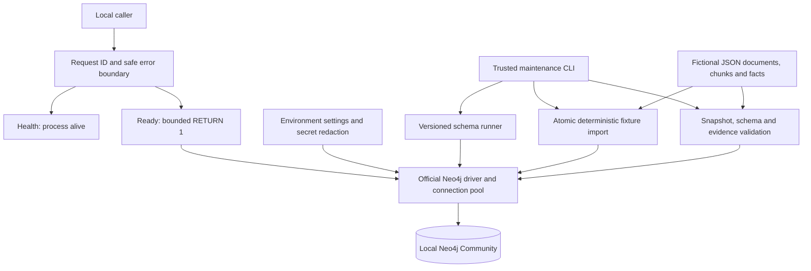

# Stage 1 architecture

This remains the Stage 1 foundation. Stage 2 extends it through [automatic extraction](AUTOMATIC_EXTRACTION.md), operational ingestion records, and an implemented extraction evaluator under `app/evaluation`.

The application owns one pooled official Neo4j driver per lifespan. Driver creation is lazy, so a database outage does not prevent the API process from starting. Shutdown closes the driver. Synchronous database calls run in FastAPI's worker threads. The request middleware assigns an ID before the route runs and keeps the same ID in JSON logs and response headers.

`GraphDatabaseClient.execute` is an internal boundary for trusted query templates. It passes values separately, sets a query timeout, selects the configured database, and converts driver errors into a safe application exception. Pool size, connection establishment, pool acquisition, and query timeouts are bounded. Automatic transaction retry time is zero, keeping readiness failures short. A successful readiness response proves the configured database can execute a query with the configured credentials.

The API exposes four read-only operational routes: `/health`, `/ready`, `/api/v1/health`, and `/api/v1/ready`. Error responses contain a generic message and request ID. Validation errors do not echo raw inputs. Logs contain JSON timestamp, level, logger, message, and request ID; they redact the configured password, credential-bearing URLs, and common token/password fields. Stack traces and request query strings are not logged by application middleware.

Fixture models reject unknown fields, invalid labels, unsupported predicates, duplicate identities, invalid directions, broken source references, quotes absent from source chunks, and timestamps without timezones. This is a data contract for a trusted fictional corpus. It is not an automatic claim-verification model.

The loader uses parameterized `MERGE` and compares the complete existing payload before reusing IDs. A node or relationship collision aborts the transaction. Every fixture record is scoped with `fixture_id`. Operational migration and import-lock nodes have separate labels. Validation compares the live graph with the expected snapshot and checks fixed evidence paths; it does not implement question-driven retrieval.

Later packages are reserved where the requested structure benefits from a stable location. Empty `schemas` and `evaluation` packages have no invented framework. Stage 1 has no embeddings, model provider, vector index, retrieval orchestration, answer generation, or agent framework.

Neo4j persists in a project-specific Docker volume. Host ports bind only to loopback. Credentials are generated locally into an ignored file. No cloud resources are used.
