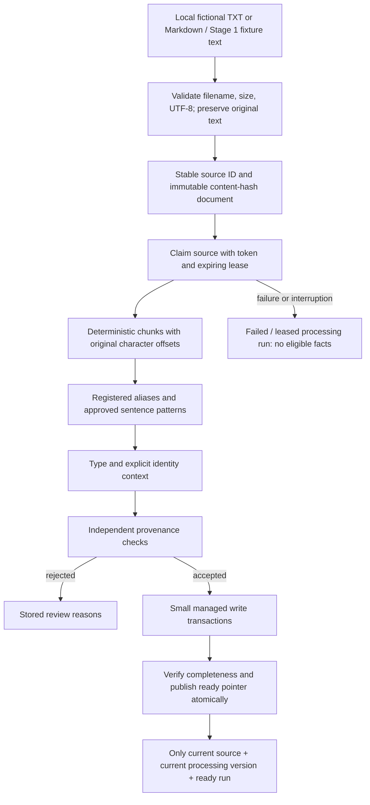

# Automatic extraction

Stage 2 ingests controlled fictional text. It has no LLM, embedding model, paid API, or HTTP mutation endpoint. Its deterministic grammar is deliberately small. New wording or unknown names are reviewed or rejected rather than completed from a model's guesses.

## Workflow



## Loading and chunking

`LocalDocumentLoader` accepts relative `.txt` and `.md` names below `data/fictional`. It rejects absolute/rooted paths, drive/UNC paths, traversal, URLs, symlinks/junctions, unsupported extensions, invalid UTF-8, NUL content, and files above the configured byte limit (64 KiB by default). It never evaluates text or fetches URLs. The CLI fixes the fictional root; remote users cannot choose filesystem paths.

The source ID identifies a logical relative filename and is portable between checkouts. Each immutable `Document` ID includes source identity and SHA-256 content hash. Fixture texts use separate source keys and retain `original_document_id`, so existing `doc:01` and other curated nodes remain unchanged. Document snapshots store source filename, hash, loader version, creation time, and a processed time after publication.

UTF-8 decoding preserves original Unicode text and CRLF characters. Offsets count Python Unicode code points, not bytes or JavaScript UTF-16 units. A chunk is exactly `document.text[start:end]`. Its ID includes document ID, processing version, chunk options, and offsets. The chunker prefers sentence boundaries and reduces overlap when needed to fit a complete sentence. It covers original whitespace as well as text. Long sentences that cannot fit in any chunk produce no partial-sentence fact.

Empty files are valid inputs and can become ready with zero chunks and zero facts. This means processing completed; it does not imply that evidence was found.

## Controlled extraction

The `Extractor` protocol separates entity and relationship candidate production. The supplied implementation uses a versioned fictional registry and complete sentence patterns. Future local/model extractors can implement the interface, but need an appropriate validator; a high confidence score cannot bypass the current rules.

| Relationship | Supported examples |
| --- | --- |
| MANAGES | `Priya manages Project Atlas.` / `Project Atlas is managed by Priya.` / `Sam leads Project Beacon.` |
| WORKS_FOR | `Morgan works for Cedar Kite.` / `Noor is employed by Tidal Lantern.` |
| USES | `Atlas uses PostgreSQL.` / `Project Atlas East utilizes Postgres.` |
| HOSTED_ON | `The PostgreSQL instance for Project Atlas is hosted on AWS.` / `Redis runs on GCP.` |
| BELONGS_TO | `Project Comet belongs to Cedar Kite.` / `Project Delta is owned by Tidal Lantern.` |

Registered platform aliases include Amazon Web Services, Microsoft Azure, and Google Cloud. Qualified people and project-specific technology instances retain distinct IDs. Negations, uncertainty, conditionals, quoted lines, fenced code, and prompt-like prefixes do not become positive assertions. Unknown extended names such as Atlas North and Priya Kapoor cannot reuse shorter registered identities.

The rules require full statements. They do not infer a direct edge from a multi-hop path. They do not infer pronouns, arbitrary product deployments, unrestricted company names, or general prose meaning. Markdown headings are ignored as facts; arbitrary inline emphasis and complex sentence coordination are outside the supported grammar.

## Lifecycle and visibility

Each logical source has an `IngestionSource` record. Each document/configuration combination has a stable `Ingestion` run. A run records `pending → processing → ready`, or `processing → failed`, with timestamps, state history, counts, rejection JSON, and a safe error category. Pending and processing are recorded in the claim transaction; the intermediate pending state is not separately observable.

A source claim is protected by a Neo4j write lock, a unique attempt token, and a renewable lease (300 seconds by default). A second active writer receives `ingestion_busy`. A retry after an expired interruption can reclaim the source; the old token cannot publish. Managed transaction callbacks use fixed IDs and timestamps prepared outside the callback, parameterized MERGE, and no production filesystem/network side effects inside the callback. See the [official driver retry contract](https://neo4j.com/docs/python-manual/current/transactions/).

Chunks, mentions, and facts commit in batches of up to 20 records. Physical staged records may exist during processing or after failure. They are **not eligible evidence**. Publication checks exact fact payloads, chunks, source links, document text/hash, and mention completeness, then sets the ready run and the source's current pointer in one transaction. Commit replay returns the same ready summary.

`VISIBLE_FACTS` is the required eligibility boundary: source and run ready, current/desired run equal, current processing version, matching content hash, and `provenance_status=verified_rule`. Bare Cypher matches do not enforce this boundary. There is no finished question-retrieval implementation in Stage 2.

Starting a changed version clears the old current pointer immediately. Historical source snapshots and assertions remain for inspection; independent sources remain eligible. A missing, deleted, oversized, linked, or corrupt local source encountered during a refresh attempt creates a failed load record and invalidates only that source's eligibility. Restoring the file and ingesting again can reuse the same valid assertion IDs. The CLI does not physically delete source history or curated evidence.

Files are re-read before publication. There is no filesystem watcher or atomic transaction spanning NTFS and Neo4j. Unannounced edits after the final read are detected at the next refresh; use the CLI to refresh modified or removed sources. If the database is unavailable before a failure can be recorded, the client reports `database_unavailable`; retry after recovery. An already committed processing claim remains hidden until recovery/reprocessing. No incomplete run is marked ready.

## Windows PowerShell commands

```powershell
Set-Location D:\Projects\GraphRAG-MultiHop
uv sync --locked
docker compose --progress plain up -d --wait
uv run python -m scripts.graph migrate
uv run python -m scripts.graph load
uv run python -m scripts.ingest ingest atlas.txt
uv run python -m scripts.ingest ingest cedar.md
uv run python -m scripts.ingest ingest conflicting-hosting.txt
uv run python -m scripts.ingest ingest review-required.md
uv run python -m scripts.ingest fixtures
uv run python -m scripts.ingest list
```

Use the returned source ID for inspection:

```powershell
uv run python -m scripts.ingest summary source:YOUR_40_CHARACTER_HASH
uv run python -m scripts.ingest rejections source:YOUR_40_CHARACTER_HASH
uv run python -m scripts.ingest validate source:YOUR_40_CHARACTER_HASH
uv run python -m scripts.ingest conflicts source:YOUR_40_CHARACTER_HASH
```

Source IDs are shown in ingestion output. The placeholder above must be replaced with an actual ID. Optional `--chunk-size 400 --overlap 40` changes the processing version and requires reprocessing. Settings are documented in `.env.example`. Run the CLI only in `APP_ENV=development`.

Potential hosting/ownership conflicts are reported with both source IDs. A differing platform can also represent a legitimate multi-platform deployment, so it is a review signal, not an automatic truth verdict. Neither assertion overwrites the other or the manually curated source.
